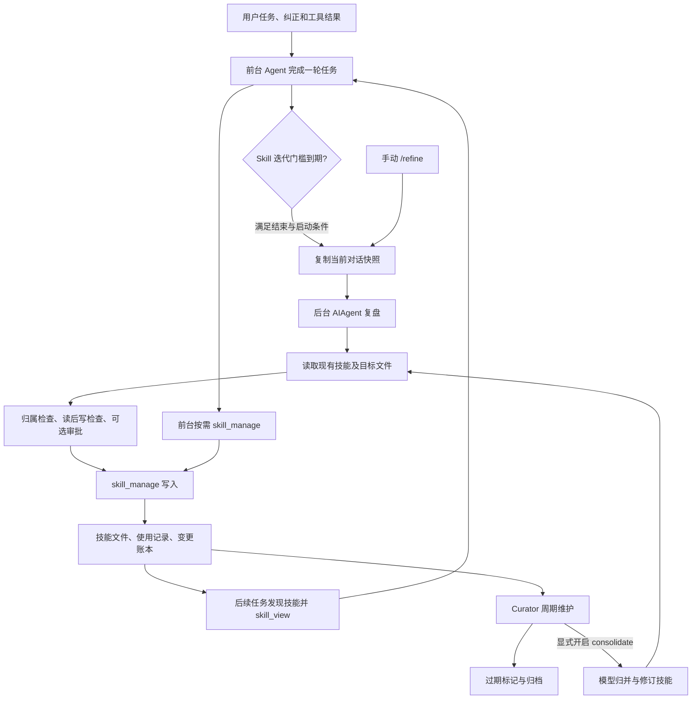

# Hermes Agent Skill 自学习能力调研

整理日期：2026-09-26。源码目录：`/Users/taiyou/project/opensource/hermes-agent`。分析基准：[665bf373e7d3](https://github.com/NousResearch/hermes-agent/commit/665bf373e7d3d7e95c875aa36def6a3ec291535c)，提交时间为 `2026-09-22T00:06:29-07:00`。

本文补充 [Hermes Agent 设计与实现](./Hermes%20Agent%20设计与实现.md)，聚焦技能经验如何产生、写入、复用与整理。结论来自当前本地源码和相关测试代码的静态核查；没有启动 Hermes、调用真实模型或运行测试，不据此宣称学习质量、任务成功率或成本已经得到验证。原总览保留其旧提交快照，版本差异见第 10 节。

## 1. 核心结论

**Hermes 的 Skill 自学习是“模型复盘经验 → 修改技能文件 → 后续任务重新加载”的外部知识更新机制。** 这条实现链不训练模型权重，也不要求先建立向量库。可执行资产是 `SKILL.md` 及其配套参考资料、脚本和模板。

源码中有三条相关路径，需要分别理解：

| 路径 | 输入与触发 | 主要产物 | 是否调用模型 |
| --- | --- | --- | --- |
| 前台学习 | 当前 Agent 在任务中发现可复用流程，或用户要求保存 | `skill_manage` 创建或修订技能 | 使用前台 Agent 的模型 |
| 会话后台复盘 | 迭代计数到期，或手动 `/refine` | 提炼用户纠正、成功方法和技能缺漏；更新受管理技能 | 新建独立 `AIAgent` 执行复盘 |
| Curator 技能库整理 | 达到维护间隔，或显式运行维护命令 | 过期标记、归档；可选合并成更通用的技能 | 默认不调用；`consolidate` 开启后才调用 |

[前台指导][front-guidance]、[后台入口][spawn]、[Curator 执行][curator-run]

它已经具备较完整的文件维护机制：归属限制、先读后改、写入锁、原子替换、可选审批、变更账本和可恢复归档。但“技能内容确实可靠”主要依靠复盘模型理解会话；**在这条自动写入链上，没有发现必须通过独立验证器、真实任务回放或效果对比才能发布的门槛。** 因此应把它理解为可自动维护的经验库，而非已经证明持续提升任务效果的训练系统。

## 2. 一条完整的学习链



图中的连线表示实现路径，不表示每次任务必然学到知识。触发可能被配置、工具能力、已有后台任务或进程退出等条件阻止；即使模型运行了，也可能没有值得保存的内容。[触发条件][finalize]、[后台运行][review-worker]

### 2.1 自动复盘按迭代计数，不按成功任务数

`prepare_iteration` 在允许技能管理且间隔大于零时累加 `_iters_since_skill`。`finalize_turn` 检查是否达到 `_skill_nudge_interval`，到期就清零，再判断是否启动后台复盘。[迭代计数][iteration]、[结束检查][finalize]

| 条件 | 当前实现 |
| --- | --- |
| 间隔配置 | `skills.creation_nudge_interval`；代码缺省回退为 `10`，示例 YAML 配置为 `15`，实际以加载配置为准 |
| 计数单位 | Agent loop 迭代；可跨该 Agent 的多个用户回合累计 |
| 回合结束条件 | 有非空 `final_response`、未中断、没有设置 `skip_background_review`，且至少一种复盘到期 |
| 工具条件 | Skill 复盘要求前台工具集合含 `skill_manage` |
| 启动门控 | 自动复盘开关、委派层级、已有后台复盘等进一步限制 |
| 前台保存影响 | 进入 `skill_manage` 工具执行前会重置 Skill 计数，此时尚不知道写入是否成功 |

[间隔初始化][init-interval]、[示例配置][example-interval]、[工具计数重置][tool-counter]、[启动门控][spawn]

这里没有要求 `completed=True` 或“业务测试通过”。计数到期也不是可靠任务队列中的一条持久学习任务：重置计数之后，后续启动仍可能被跳过。因此不能把“做了十次任务”理解成“已经自动学会一项技能”。

### 2.2 手动 `/refine` 与自动复盘共用实现

CLI 的 `/refine [关注点]` 传入当前会话快照，启用 Memory 复盘，并在工具可用时启用 Skill 复盘；`explicit=True` 绕过本地模型空闲延后。它依然以 `background_review` 写入来源运行，Skill 的受管理范围和先读后改约束仍然生效。[CLI 命令][cli-refine]、[复盘运行][review-fork]

当前快照有两个值得排障时注意的细节：

- `run_agent.py` 的 enabled / delegate 门控由 `focus is None` 决定。裸 `/refine` 仍经过这两个门控；带非空关注点时绕过，不能笼统说“所有手动复盘都无条件绕过开关”。
- Gateway 的 `/refine` 调用没有传 `explicit=True`，与 CLI 并不完全相同；没有关注点时，仍可能走空闲延后等默认行为。应核对使用入口，不能仅凭斜杠命令名字推断行为一致。

[共用入口][spawn]、[Gateway 命令][gateway-refine]

## 3. 后台模型究竟看到了什么

### 3.1 快照、独立 Agent 与共享技能库

后台复盘建立新的 `AIAgent`，不是操作系统层面的 fork，也不是修改前台当前回复。入口会结构化复制消息，避免后台处理嵌套 `tool_calls`、内容块时污染前台历史；后台 Agent 关闭会话持久化并解绑会话数据库，技能默认写入当前 profile 的目录，配置 `skills.create_dir` 时新建技能可改写到指定位置。[快照入口][spawn]、[实例构建][build-fork]、[创建路径解析][create-path]

两种模型路由采取不同输入策略：

| 复盘模型 | 输入策略 | 取舍 |
| --- | --- | --- |
| 与前台相同 | 继承运行时、缓存系统提示、工具定义和相关缓存上下文，重放当前会话快照 | 尽量复用前缀缓存；仍有调用和输入成本 |
| 显式路由到另一模型 | `_digest_history` 保留最近约 24 条消息，必要时扩展边界以避免从工具结果中间开始；更早用户文本截为 300 字符，助手文本截为 200 字符，保留工具名 | 缩减冷缓存成本，但旧工具结果细节会丢失 |

[运行时解析][review-runtime]、[历史摘要][history-digest]、[缓存对齐][build-fork]

这里的历史是“当前对话快照”，可能已经被上下文压缩；它不是自动遍历全部历史会话、跨所有任务聚合经验的离线训练集。Curator 的输入也主要是技能候选清单和按需读取的文件，不能把这两条流程合起来描述成全历史自动挖掘系统。

### 3.2 工具限制在执行侧落实

同模型复盘保留前台工具 schema 以维持缓存前缀，但工具分发另有线程白名单。默认允许技能工具以及 `read_file`、`search_files`；普通终端和文件修改工具被拒绝，技能变更通过 `skill_manage` 完成。配置 `auxiliary.background_review.extra_tools` 可以额外放行已存在于父 Agent 工具表中的工具。[工具白名单][review-whitelist]

**Skill-only 复盘默认没有 `memory` 工具。** 只有本次 `review_memory=True` 且内置 Memory / 用户档案功能开启，才加入该工具；这是执行权限约束，不只是提示词建议。显式配置的额外工具属于另行放宽权限的入口。[范围测试][test-memory-scope]

这些是应用内工具边界，不应等同于操作系统沙箱或服务端多租户授权；`extra_tools` 等配置会改变可操作范围。

### 3.3 前台优先，后台并非必达

新用户回合会取消正在运行的复盘，等待确认最多约 2 秒后继续。已完成的技能写入不会因此整体回滚。后台使用 daemon thread，也不具备进程退出后的必达保证。[取消实现][cancel-review]

Hermes 管理的本地 `llama-server` 还可以通过空闲队列延后复盘；队列按会话合并快照，默认等待前台安静和服务空闲，超时可放宽派发条件，被前台抢占后有有限重排。它是本地资源协调机制，不是持久化学习作业系统。[空闲队列][idle-queue]、[重排入口][requeue]

## 4. 什么经验会被写成 Skill

### 4.1 模型主要识别三类信号

复盘提示明确要求关注：用户纠正做事方法或输出形式；非平凡任务中发现可复用的成功办法；已加载技能缺步骤、命令不正确或遗漏陷阱。它鼓励积极维护，但仍允许没有可保存内容时不写入。[Skill 复盘提示][skill-prompt]

优先级是：

1. 修订本次使用过、且允许后台维护的技能。
2. 查找已有同类技能，把经验合入现有主题。
3. 把详细材料放入适合的 `references/`、`scripts/`、`templates/`，从主技能引用。
4. 没有合适载体时，再创建覆盖一类任务的新技能。

它不是“每个会话生成一份总结文件”。目标是减少后续任务需要重新摸索的步骤，并保持技能库可以发现和复用。

### 4.2 提示词明确反对把偶然经历固化成规则

| 希望保留 | 希望避免 |
| --- | --- |
| 带命令、步骤、选择条件的操作流程 | 只有事件背景、聊天摘要，没有可执行方法 |
| “做什么 / 不做什么 + 原因”的通用陷阱说明 | PR 编号、日期、单次工单叙事占据主体 |
| 修正已有错误句子，合并重复规则 | 在错误规则后不断追加 UPDATE，形成冲突 |
| 已验证的安装或配置修复步骤 | 因一次缺依赖、缺凭据就永久宣称某工具不可用 |
| 在对应任务技能中记录用户的做事标准 | 把同一规则无差别复制到 Skill 和 Memory |

[经验提炼规则][lesson-rules]、[禁止捕获内容][capture-exclusions]、[合并复盘提示][combined-prompt]

例如，用户要求“报告必须先列结论，并在数字后附来源”，如果已有受管理的报告技能，合理产物是直接修正报告结构及验收步骤。某次抓取失败但没有找到有效修复，则不能据此写入“以后不要用该抓取工具”。这些是对源码提示意图的说明，不是本次真实运行产物。

### 4.3 Skill 与 Memory 的分工

Skill 保存某类任务的执行方式，包括用户对这类任务的格式、工具、质量标准；Memory 保存适合跨任务复用的简短事实或偏好。合并复盘强调给经验选择一个主要归宿，避免重复存储。实际分类仍由模型判断，并没有一个确定性的分类器保证永远选对。[经验提炼规则][lesson-rules]、[合并复盘提示][combined-prompt]

## 5. 写入如何受控

### 5.1 `created_by` 是维护资格标记，不是作者证明

使用记录位于当前 Hermes home 下的 `skills/.usage.json`，没有把计数写入 `SKILL.md` 的 frontmatter。[使用状态][usage-file]

| 技能来源或状态 | 是否默认允许后台修改 |
| --- | --- |
| 后台复盘创建，记录为 `created_by="agent"` | 可以，但仍需通过其他保护 |
| 用户指示前台创建，包括 `/learn` 一类路径，记录为 `created_by="learn"` | 不自动纳入维护 |
| 手写技能、无记录技能或 `created_by=null` | 不允许；不存在“第一次写入默认放行” |
| 用户执行 `hermes curator adopt <name>` 后 | 符合资格的本地技能可以被纳入维护 |
| Bundled、Hub 安装、外部目录技能 | 后台写入拒绝 |
| Pinned 技能 | 后台维护拒绝；前台可修改内容，但删除另有保护 |

[记录创建来源][record-created]、[维护资格与 adopt][managed-record]、[后台写入保护][write-guards]

`adopt` 可以把用户技能标记为 `agent`，源码也明确把该字段视为维护 opt-in。因此不能拿 `created_by="agent"` 证明内容一定由模型生成，更不能把它当成租户 / 员工访问权限。归属记录读取异常时，后台所有权检查会拒绝修改，而不是假定有权限。[保护测试][test-ownership]

### 5.2 修改前必须重新读取目标文件

后台维护现有技能时，必须在**本次复盘**读取当前目标。修改 `SKILL.md` 要读主文件；修改支持文件要读对应支持文件。上一轮历史中出现过文件内容，不能代替这次读取；新建文件没有“先读不存在内容”的要求。[读后写检查][read-guard]、[具体写入][guarded-write]

`skill_view` 的后台路径还跳过普通会话读取去重，避免只返回“已经加载”的短提示而没有建立读标记。`read_file` 也有与读标记配合的实现，后台白名单因此允许通过它检查文件。[技能加载包装][skill-view-bump]、[白名单说明][review-whitelist]

读后写保护保证模型至少加载过目标，不能证明它正确理解了内容，也不等于读取时的版本在写入前绝对没有被其他人修改。写入锁保护工具内部的读改写窗口；定点 patch 则进一步检查匹配情况。

### 5.3 文件更新有校验、锁和回滚，但不是效果验证

`skill_manage` 支持创建、整篇编辑、定点 patch、删除、写入及移除支持文件。写入过程包含名称和路径检查、frontmatter 与大小校验、每技能锁、原子文件替换；patch 对匹配失败或歧义返回错误和修复提示。[工具入口][manage-entry]、[校验][manage-validation]、[patch 实现][patch]

`operations` 支持多操作批次：先锁定所有目标并做快照，某个操作失败时恢复文件；`delete` 必须独占一个批次，不能和其他操作混合。这里应理解为文件变更的批次恢复机制，不能推断账本、遥测和外部同步也具备数据库事务式整体回滚。[批次实现][manage-batch]

安全扫描由 `skills.guard_agent_created` 控制，当前默认关闭；开启后扫描拒绝会还原该次写入。Lint 提示可能只是 advisory，不阻止创建。格式有效、安全扫描通过或工具返回成功，都不能证明技能对业务任务有效。[写入及扫描][guarded-write]、[创建与 lint][create-skill]、[默认配置][skills-defaults]

### 5.4 默认直接写入，可以配置审批

`skills.write_approval` 默认 `false`。设为 `true` 后，前台和后台技能写入均先保存为 pending proposal，通过 `/skills pending`、`/skills diff <id>`、`/skills approve|reject <id>` 处理，审批回放时才真正执行修改。[默认配置][skills-defaults]、[审批入口][write-gate]

要区分工具结果中的 `success=true, staged=true` 和已经写入成功：前者只表示提案被保存。审批提供人工检查入口，本身也不是自动测试。另一个实现边界是 `_run_write_gate` 在无法导入 `write_approval` 时直接放行；不能把此实现描述为所有故障情况下都 fail-closed 的发布系统。[审批实现][write-gate]

## 6. 写完以后如何复用，怎样证明学到了

### 6.1 通过技能目录发现，正文按需加载

系统提示构建器生成技能索引，引导模型先判断相关性，再用 `skill_view` 加载正文。技能内容并非默认全部注入；匹配主要依靠索引信息和模型判断。`skills.auto_load` 是另一条显式预加载路径。[索引指导][skill-index]、[预加载][auto-load]

成功修改会清理技能索引缓存与磁盘快照，使后续构建可以看到变化。它不是把新内容推送进所有已经运行的 Agent 上下文；已缓存的系统提示、已加载正文、一次性 auto-load 结果各有生命周期。验证复用时，应观察新会话或明确重读后的内容，不能仅看文件已经改了。[写后处理][post-write]、[预加载生命周期][auto-load]

### 6.2 使用遥测是一组可观察信号

`.usage.json` 记录 `use_count`、`view_count`、`patch_count`、`patch_generation`、最后使用 / 查看 / 修改时间，以及 active / stale / archived 和 pinned 等状态。[使用记录结构][usage-record]

`bump_use` 还区分再次加载、修改后再次加载；可以帮助观察“创建 → 修订 → 复用”的轨迹。但是当前 `skill_view` 成功就会增加 view 和 use，后台复盘读取也走该包装。因此：

- `use_count` 增长能说明发生了加载，不能证明业务任务按技能成功完成。
- `reuse_after_patch` 是修改后再次加载的信号，不是效果提升评分。
- 最近查看或修订会刷新 Curator 的活动时间；整理活动本身也可能影响过期判断。

[加载计数][skill-view-bump]、[使用及修改遥测][usage-events]、[活动时间][activity-time]

### 6.3 验证学习应分四层

| 层级 | 建议检查的证据 | 不能由它推出的结论 |
| --- | --- | --- |
| 复盘发生 | 模型调用数、复盘完成日志、实际运行时 | 已经生成有用知识 |
| 写入发生 | 技能 diff、成功工具结果、账本 before/after；排除只有 staged 的结果 | 内容正确、可复用 |
| 知识复用 | 后续任务加载了该版本；指令进入实际上下文 | 任务表现提高 |
| 任务改善 | 新案例成功率、约束遵守、用户纠正次数、耗时和成本的对照 | 对所有任务或模型都有效 |

前三层可由现有机制提供较多观察点，第四层需要单独设计评测。本次没有执行这些效果实验。

## 7. Curator：技能库维护的第二条流程

### 7.1 默认只有确定性的生命周期管理

当前默认配置如下，不代表用户当前运行配置：[Curator 默认配置][curator-defaults]

| 配置 | 默认值 | 含义 |
| --- | --- | --- |
| `curator.enabled` | `true` | 允许维护 |
| `interval_hours` | `168` | 两次维护之间至少一周 |
| `min_idle_hours` | `2` | 调用方提供 idle 测量时检查 |
| `stale_after_days` | `14` | 长期无活动标记 stale |
| `archive_after_days` | `30` | 长期无活动移入归档 |
| `consolidate` | `false` | 默认不启动 LLM 合并 |
| `prune_builtins` | `false` | 默认不把 bundled 技能纳入确定性过期归档 |
| `archive_ttl_days` | `0` | 默认不按 TTL 清除；purge 是显式操作 |
| `backup.enabled / keep` | `true / 2` | 合并前整库快照开启，常规快照保留两份 |

它由调用入口检查间隔和空闲条件，不是独立常驻的 cron 守护服务。首次观察会先初始化运行时间，推迟一个间隔，避免刚安装就整理技能库。`maybe_run_curator` 只有在传入 idle 测量时才检查空闲门槛，因此也不能把“空闲两小时”理解成对所有调用路径都无条件成立。[调度门控][curator-schedule]、[调用入口][curator-entry]

过期判断使用最近使用、查看或修改时间，没有活动则回退到创建时间。Pinned 和 cron 引用的技能被确定性清理跳过；有近期活动的 stale 技能可以恢复 active。归档是移动到 `skills/.archive/`，与永久删除不同。[状态迁移][curator-transitions]

### 7.2 开启模型合并后，输入是整个候选技能库

合并提示要求发现主题重叠，把零散技能归入更通用的 umbrella skill，同时保留独特步骤和参考资料。候选列表包含 provenance、状态、pinned、cron 引用、使用与修改次数等；正文再通过技能工具读取。[候选与合并入口][consolidation]、[合并提示][curator-prompt]

这一 Agent 与会话后台复盘配置不同：

- 使用 `auxiliary.curator` 模型槽位，支持旧版 `curator.auxiliary` 回退，否则从主模型配置解析。
- 工具集设为 `skills`，没有 terminal；修改经过技能工具及账本路径。
- 同样设置 `background_review` 写入来源，沿用后台技能保护，并关闭自身 nudge。
- **`max_iterations=9999`，没有复用会话复盘的 16 次限制。** 本入口也没有设置会话复盘专用的累计输入预算，不能拿后者预算估算大规模合并成本。

[Curator 模型与 Agent 构造][curator-model]

后台 `delete` 要求 `absorbed_into` 指向已存在且不是自身的技能，然后执行可恢复归档。没有承接目标的清理交给确定性过期流程；前台 `delete` 仍是实际删除。这是“声明了存在的承接目标”的结构检查，不能证明旧技能的每一项知识都已被目标完整吸收。[删除保护][delete-guard]、[删除分支][delete-skill]

### 7.3 `--dry-run --consolidate` 有提示词边界

`dry_run=True` 会跳过确定性状态迁移、不推进正常运行计数，但仍可生成报告。开启 consolidate 后，dry-run 的合并部分是在 prompt 前加只读说明，随后仍调用同一个拥有 `skill_manage` 的 Agent；本入口没有撤掉写工具或设置只读执行门控。

因此不能把它当作不可写的沙箱预演。需要严格只读预览时，应额外依靠隔离副本或写入门控。这是根据当前调用链得出的边界判断，未实际运行模型尝试突破 dry-run。[dry-run 分支][curator-run]、[提示注入位置][consolidation]、[Agent 工具集][curator-model]

## 8. 审计、恢复与模型成本

### 8.1 磁盘上保存了哪些证据

以下列出默认布局，路径相对于当前 `get_hermes_home()` 解析的 profile home；默认 home 常见为 `~/.hermes`，不要把它写死成多用户共享目录。`skills.create_dir` 可以改变新建技能的位置，部署时还需核对实际配置。[创建路径解析][create-path]

| 路径 | 内容与用途 |
| --- | --- |
| `skills/<分类>/<技能>/SKILL.md` 或 `skills/<技能>/SKILL.md` | 技能主体；配套目录保存参考资料、模板或脚本 |
| `skills/.usage.json` | 维护资格、使用 / 查看 / 修改计数和生命周期 |
| `skills/.curator_ledger.jsonl` | 技能修改账本，记录 actor、action、evidence、before/after 文件清单 |
| `.curator_backups/blobs/` | 账本引用的内容寻址文件数据 |
| `skills/.archive/` | 可恢复的归档技能 |
| `skills/.curator_backups/` | 合并维护前的整库快照 |
| `logs/curator/<运行时间>/run.json`、`REPORT.md` | Curator 运行报告及变更分类 |

[使用与归档路径][usage-file]、[账本实现][ledger]、[快照实现][backup]、[报告实现][reports]

可以通过 `hermes curator ledger --skill <name>` 查看相关修改，使用 `hermes curator rollback <entry-id>` 回退单条变更；整库快照、restore 和 purge 另有维护命令。回退与恢复会修改文件，本次没有执行。[CLI 定义][curator-cli]

账本、遥测、快照多处采用 best-effort：记录失败不阻止技能修改，合并前快照失败也不阻止维护。这提高可用性，但意味着“每次写入必有完整审计、每次整理必能恢复”不是硬保证。[写后处理][post-write]、[账本追加][ledger-append]、[维护快照分支][curator-run]

### 8.2 复盘实际用了哪个模型

会话后台复盘默认继承**前台当前运行时**。只有 `auxiliary.background_review.provider` 是非 auto 的具体值、同时设置 model、且与父模型组合不同，才走单独路由；解析失败会告警并回退父运行时。仅改一个 model 字段，不一定按预期切换。[运行时解析][review-runtime]

应区分三种信息：

1. 配置文件是期望值，要同时检查 background_review 和 curator 两个槽位。
2. 复盘 Agent 解析后的 `model / provider / base_url` 是客户端实际运行时。后台会快照这些字段及 token / API 调用计数，在父会话存在数据库时以 `task="background_review"` 记入 `session_model_usage`。
3. 要核实实际发往服务端的模型，应检查脱敏请求中的 model、目标端点，以及服务端返回或提供方日志。客户端 model 别名不能独立证明网关背后的最终部署。

[用量记录][review-usage]

完成日志 `Background review complete: ...` 记录调用数、输入、输出、缓存读取和结果，**该行没有直接输出模型名**。Curator 报告也包含 model / provider，但其元数据在构造 Agent 前从解析结果赋值；发生回退或模型别名映射时，仍应以实际请求为准。[完成日志][review-log]、[Curator 模型元数据][curator-model]

### 8.3 会话复盘的预算是累计输入预算

当前默认计算为：

```text
已知有效上下文窗口：min(600000, max(1, floor(context_window × 0.75)))
未知上下文窗口：120000
显式 max_input_tokens > 0：使用配置值
显式 max_input_tokens <= 0：关闭这项预算限制
```

例如上下文窗口为 65,536，默认预算为 49,152。这是多次请求累计的输入 token，不是仅新增文本，也不是输出上限；缓存输入仍属于模型输入。预算在下一次迭代前检查，导致越界的请求已经执行，不构成请求前的精确费用上限。会话复盘另有最多 16 次迭代约束。[预算解析][review-budget]、[循环检查][budget-check]、[预算测试][test-budget]

## 9. 已有测试能证明什么

本次只核查测试源码，未执行。下面列出可追溯的测试目标，不能据此声称本机已全部通过。

| 测试位置 | 断言或覆盖目标 | 证据边界 |
| --- | --- | --- |
| `test_background_review_input_budget.py` | 模拟响应累计达到预算后不再发下一请求；验证 65,536 → 49,152 和未知窗口回退 | 控制流与数值计算；不测真实模型成本 |
| `test_background_review_memory_scope.py` | Skill-only 不含 memory；Memory 复盘才放行；明确复盘保留后台来源 | 工具权限范围；不测经验分类正确率 |
| `test_skill_manager_tool.py` | 路径与 patch 校验、并发修改、后台归属保护、adopt 后维护资格等 | 文件维护行为；不等于生成内容正确 |

[预算测试][test-budget]、[范围测试][test-memory-scope]、[技能工具测试][test-skill-manage]

如果进一步实测，建议在隔离的 `HERMES_HOME` 和技能库副本中，用一组固定任务建立以下对照：同一个模型、相同工具权限，分别开启和关闭学习；先用教学任务产生经验，再用未见过的同类任务验证复用，同时保留无关任务检查错误规则是否扩散。记录实际请求模型、文件版本、加载记录和任务验收结果。

这属于后续实验设计，不是 Hermes 已内置的强制发布流程。项目测试运行还应遵循仓库要求，通过 `scripts/run_tests.sh` 进行隔离，避免使用真实用户技能库或凭据。

## 10. 与原总览快照的差异

原 [Hermes Agent 设计与实现](./Hermes%20Agent%20设计与实现.md) 固定在 `245e48008fa8`；本文固定在 `665bf373e7d3`。下面只记录本次核查到、会影响理解或运维的差异，不把原文的版本限定结论直接当作当前行为。

| 主题 | 当前快照应采用的表述 |
| --- | --- |
| 会话复盘累计输入预算 | 按上下文窗口的 75% 推导，上限 600k；未知窗口 120k，不再笼统写固定 600k |
| Skill-only 与 Memory | 不仅提示词不同，默认执行白名单也排除 memory |
| 显式复盘来源 | 仍为 background_review；CLI explicit 单独表示 attended，不解除 Skill 保护 |
| 技能来源标记 | 前台创建记录为 learn，后台为 agent；agent 也可由 adopt 设置，表示维护资格 |
| 模型合并成本 | Curator 默认关闭合并；合并 Agent 的迭代上限与会话复盘不同 |
| 文件更新能力 | 当前支持 operations 批次、跨目标锁和失败恢复；delete 不能混入其他操作 |

[预算][review-budget]、[工具范围][review-whitelist]、[显式复盘][review-fork]、[创建来源][record-created]、[Curator][curator-model]、[批次][manage-batch]

## 11. 对自学习系统设计的启发

**值得借鉴的是把模型判断和确定性文件维护分开。** 模型负责提炼、归类和提出变更；运行时负责允许谁修改哪些内容、怎样落盘、怎样观察和恢复。Skill 用 Markdown 主体加配套资源，便于人工检查，也容易接入不同 Agent。[经验提示][skill-prompt]、[写入保护][write-guards]

若把这套思路移植到多用户、多员工系统，还需要补齐 Hermes 这条本地流程没有证明的几个环节：

- 用服务端可信的用户 / 员工范围绑定读取、写入、缓存和后台任务；不能用 profile 路径或 `created_by` 字段代替授权。
- 对重要技能采用“候选版本 → 可执行验收 → 发布版本 → 后续效果观察”，把内容有效性与文件写入成功分开。
- 保留源任务、原始证据和版本关系，允许重建派生技能；不要只留下模型整理后的规则。
- 对学习机会建立持久作业和幂等处理，避免把 daemon thread 的尽力执行误当成必达。
- 将模型调用和库维护分开预算，尤其单独限制大范围技能合并。

这些是基于源码边界提出的设计建议，未在本次调研中实施。Hermes 已经把经验积累接进日常 Agent 工作流；要证明它“越用越好”，仍需要对后续真实任务建立独立、可复现的效果证据。

## 源码索引

所有链接固定到本次分析提交，避免主分支移动后行号失效。

| 阅读入口 | 关注内容 |
| --- | --- |
| [run_agent.py][spawn] / [turn_finalizer.py][finalize] | 什么时候启动复盘 |
| [background_review.py][review-fork] | 复盘 Agent、输入、工具与执行 |
| [skill_manager_tool.py][manage-entry] / [skill_manager_guards.py][write-guards] | 写入和保护 |
| [skill_manager_batch.py][manage-batch] | 批次修改与失败恢复 |
| [skills_tool.py][skill-view-bump] / [prompt_builder.py][skill-index] | 加载、复用与计数 |
| [skill_usage.py][managed-record] / [skill_ledger.py][ledger] | 维护资格与审计 |
| [curator.py][curator-run] / [curator_backup.py][backup] | 技能库整理和恢复 |
| [config_defaults.py][curator-defaults] | 配置默认值 |

[front-guidance]: https://github.com/NousResearch/hermes-agent/blob/665bf373e7d3d7e95c875aa36def6a3ec291535c/agent/prompt_builder.py#L256-L262
[spawn]: https://github.com/NousResearch/hermes-agent/blob/665bf373e7d3d7e95c875aa36def6a3ec291535c/run_agent.py#L775-L844
[finalize]: https://github.com/NousResearch/hermes-agent/blob/665bf373e7d3d7e95c875aa36def6a3ec291535c/agent/turn_finalizer.py#L676-L706
[iteration]: https://github.com/NousResearch/hermes-agent/blob/665bf373e7d3d7e95c875aa36def6a3ec291535c/agent/turn_iteration_prep.py#L115-L124
[init-interval]: https://github.com/NousResearch/hermes-agent/blob/665bf373e7d3d7e95c875aa36def6a3ec291535c/agent/agent_init.py#L1330-L1335
[example-interval]: https://github.com/NousResearch/hermes-agent/blob/665bf373e7d3d7e95c875aa36def6a3ec291535c/cli-config.yaml.example#L1100-L1115
[tool-counter]: https://github.com/NousResearch/hermes-agent/blob/665bf373e7d3d7e95c875aa36def6a3ec291535c/agent/tool_executor.py#L708-L718
[cli-refine]: https://github.com/NousResearch/hermes-agent/blob/665bf373e7d3d7e95c875aa36def6a3ec291535c/hermes_cli/cli_commands_mixin.py#L2245-L2265
[gateway-refine]: https://github.com/NousResearch/hermes-agent/blob/665bf373e7d3d7e95c875aa36def6a3ec291535c/gateway/slash_commands_goals.py#L172-L192
[build-fork]: https://github.com/NousResearch/hermes-agent/blob/665bf373e7d3d7e95c875aa36def6a3ec291535c/agent/background_review.py#L866-L1035
[review-runtime]: https://github.com/NousResearch/hermes-agent/blob/665bf373e7d3d7e95c875aa36def6a3ec291535c/agent/background_review.py#L222-L280
[history-digest]: https://github.com/NousResearch/hermes-agent/blob/665bf373e7d3d7e95c875aa36def6a3ec291535c/agent/background_review.py#L301-L336
[review-whitelist]: https://github.com/NousResearch/hermes-agent/blob/665bf373e7d3d7e95c875aa36def6a3ec291535c/agent/background_review.py#L1074-L1115
[review-fork]: https://github.com/NousResearch/hermes-agent/blob/665bf373e7d3d7e95c875aa36def6a3ec291535c/agent/background_review.py#L1133-L1195
[review-worker]: https://github.com/NousResearch/hermes-agent/blob/665bf373e7d3d7e95c875aa36def6a3ec291535c/agent/background_review.py#L1205-L1287
[cancel-review]: https://github.com/NousResearch/hermes-agent/blob/665bf373e7d3d7e95c875aa36def6a3ec291535c/agent/background_review.py#L24-L147
[idle-queue]: https://github.com/NousResearch/hermes-agent/blob/665bf373e7d3d7e95c875aa36def6a3ec291535c/agent/review_idle_queue.py#L1-L160
[requeue]: https://github.com/NousResearch/hermes-agent/blob/665bf373e7d3d7e95c875aa36def6a3ec291535c/run_agent.py#L846-L871
[skill-prompt]: https://github.com/NousResearch/hermes-agent/blob/665bf373e7d3d7e95c875aa36def6a3ec291535c/agent/background_review.py#L417-L501
[lesson-rules]: https://github.com/NousResearch/hermes-agent/blob/665bf373e7d3d7e95c875aa36def6a3ec291535c/agent/background_review.py#L362-L390
[capture-exclusions]: https://github.com/NousResearch/hermes-agent/blob/665bf373e7d3d7e95c875aa36def6a3ec291535c/agent/background_review.py#L392-L415
[combined-prompt]: https://github.com/NousResearch/hermes-agent/blob/665bf373e7d3d7e95c875aa36def6a3ec291535c/agent/background_review.py#L503-L568
[usage-file]: https://github.com/NousResearch/hermes-agent/blob/665bf373e7d3d7e95c875aa36def6a3ec291535c/tools/skill_usage.py#L1-L55
[record-created]: https://github.com/NousResearch/hermes-agent/blob/665bf373e7d3d7e95c875aa36def6a3ec291535c/tools/skill_usage.py#L519-L531
[managed-record]: https://github.com/NousResearch/hermes-agent/blob/665bf373e7d3d7e95c875aa36def6a3ec291535c/tools/skill_usage.py#L275-L342
[write-guards]: https://github.com/NousResearch/hermes-agent/blob/665bf373e7d3d7e95c875aa36def6a3ec291535c/tools/skill_manager_guards.py#L133-L218
[read-guard]: https://github.com/NousResearch/hermes-agent/blob/665bf373e7d3d7e95c875aa36def6a3ec291535c/tools/skill_manager_guards.py#L220-L230
[guarded-write]: https://github.com/NousResearch/hermes-agent/blob/665bf373e7d3d7e95c875aa36def6a3ec291535c/tools/skill_manager_tool.py#L359-L378
[manage-validation]: https://github.com/NousResearch/hermes-agent/blob/665bf373e7d3d7e95c875aa36def6a3ec291535c/tools/skill_manager_tool.py#L85-L199
[create-path]: https://github.com/NousResearch/hermes-agent/blob/665bf373e7d3d7e95c875aa36def6a3ec291535c/tools/skill_manager_tool.py#L210-L219
[manage-entry]: https://github.com/NousResearch/hermes-agent/blob/665bf373e7d3d7e95c875aa36def6a3ec291535c/tools/skill_manager_tool.py#L752-L803
[patch]: https://github.com/NousResearch/hermes-agent/blob/665bf373e7d3d7e95c875aa36def6a3ec291535c/tools/skill_manager_tool.py#L460-L504
[create-skill]: https://github.com/NousResearch/hermes-agent/blob/665bf373e7d3d7e95c875aa36def6a3ec291535c/tools/skill_manager_tool.py#L397-L443
[manage-batch]: https://github.com/NousResearch/hermes-agent/blob/665bf373e7d3d7e95c875aa36def6a3ec291535c/tools/skill_manager_batch.py#L184-L267
[write-gate]: https://github.com/NousResearch/hermes-agent/blob/665bf373e7d3d7e95c875aa36def6a3ec291535c/tools/skill_manager_tool.py#L598-L660
[post-write]: https://github.com/NousResearch/hermes-agent/blob/665bf373e7d3d7e95c875aa36def6a3ec291535c/tools/skill_manager_tool.py#L712-L749
[skill-view-bump]: https://github.com/NousResearch/hermes-agent/blob/665bf373e7d3d7e95c875aa36def6a3ec291535c/tools/skills_tool.py#L690-L724
[skill-index]: https://github.com/NousResearch/hermes-agent/blob/665bf373e7d3d7e95c875aa36def6a3ec291535c/agent/prompt_builder.py#L1340-L1387
[auto-load]: https://github.com/NousResearch/hermes-agent/blob/665bf373e7d3d7e95c875aa36def6a3ec291535c/agent/system_prompt.py#L316-L346
[usage-record]: https://github.com/NousResearch/hermes-agent/blob/665bf373e7d3d7e95c875aa36def6a3ec291535c/tools/skill_usage.py#L345-L364
[usage-events]: https://github.com/NousResearch/hermes-agent/blob/665bf373e7d3d7e95c875aa36def6a3ec291535c/tools/skill_usage.py#L490-L516
[activity-time]: https://github.com/NousResearch/hermes-agent/blob/665bf373e7d3d7e95c875aa36def6a3ec291535c/tools/skill_usage.py#L122-L144
[skills-defaults]: https://github.com/NousResearch/hermes-agent/blob/665bf373e7d3d7e95c875aa36def6a3ec291535c/hermes_cli/config_defaults.py#L1435-L1462
[curator-defaults]: https://github.com/NousResearch/hermes-agent/blob/665bf373e7d3d7e95c875aa36def6a3ec291535c/hermes_cli/config_defaults.py#L1467-L1497
[curator-run]: https://github.com/NousResearch/hermes-agent/blob/665bf373e7d3d7e95c875aa36def6a3ec291535c/agent/curator.py#L891-L964
[curator-schedule]: https://github.com/NousResearch/hermes-agent/blob/665bf373e7d3d7e95c875aa36def6a3ec291535c/agent/curator.py#L139-L158
[curator-entry]: https://github.com/NousResearch/hermes-agent/blob/665bf373e7d3d7e95c875aa36def6a3ec291535c/agent/curator.py#L1147-L1161
[curator-transitions]: https://github.com/NousResearch/hermes-agent/blob/665bf373e7d3d7e95c875aa36def6a3ec291535c/agent/curator.py#L188-L240
[consolidation]: https://github.com/NousResearch/hermes-agent/blob/665bf373e7d3d7e95c875aa36def6a3ec291535c/agent/curator.py#L807-L889
[curator-prompt]: https://github.com/NousResearch/hermes-agent/blob/665bf373e7d3d7e95c875aa36def6a3ec291535c/agent/curator.py#L270-L444
[curator-model]: https://github.com/NousResearch/hermes-agent/blob/665bf373e7d3d7e95c875aa36def6a3ec291535c/agent/curator.py#L986-L1109
[delete-guard]: https://github.com/NousResearch/hermes-agent/blob/665bf373e7d3d7e95c875aa36def6a3ec291535c/tools/skill_manager_guards.py#L241-L261
[delete-skill]: https://github.com/NousResearch/hermes-agent/blob/665bf373e7d3d7e95c875aa36def6a3ec291535c/tools/skill_manager_tool.py#L507-L541
[ledger]: https://github.com/NousResearch/hermes-agent/blob/665bf373e7d3d7e95c875aa36def6a3ec291535c/tools/skill_ledger.py#L1-L124
[ledger-append]: https://github.com/NousResearch/hermes-agent/blob/665bf373e7d3d7e95c875aa36def6a3ec291535c/tools/skill_ledger.py#L273-L297
[backup]: https://github.com/NousResearch/hermes-agent/blob/665bf373e7d3d7e95c875aa36def6a3ec291535c/agent/curator_backup.py
[reports]: https://github.com/NousResearch/hermes-agent/blob/665bf373e7d3d7e95c875aa36def6a3ec291535c/agent/curator.py#L650-L790
[curator-cli]: https://github.com/NousResearch/hermes-agent/blob/665bf373e7d3d7e95c875aa36def6a3ec291535c/hermes_cli/curator.py#L660-L697
[review-usage]: https://github.com/NousResearch/hermes-agent/blob/665bf373e7d3d7e95c875aa36def6a3ec291535c/agent/background_review.py#L757-L790
[review-log]: https://github.com/NousResearch/hermes-agent/blob/665bf373e7d3d7e95c875aa36def6a3ec291535c/agent/background_review.py#L803-L810
[review-budget]: https://github.com/NousResearch/hermes-agent/blob/665bf373e7d3d7e95c875aa36def6a3ec291535c/agent/background_review.py#L150-L202
[budget-check]: https://github.com/NousResearch/hermes-agent/blob/665bf373e7d3d7e95c875aa36def6a3ec291535c/agent/conversation_loop.py#L109-L128
[test-budget]: https://github.com/NousResearch/hermes-agent/blob/665bf373e7d3d7e95c875aa36def6a3ec291535c/tests/agent/test_background_review_input_budget.py#L147-L259
[test-memory-scope]: https://github.com/NousResearch/hermes-agent/blob/665bf373e7d3d7e95c875aa36def6a3ec291535c/tests/agent/test_background_review_memory_scope.py#L25-L130
[test-ownership]: https://github.com/NousResearch/hermes-agent/blob/665bf373e7d3d7e95c875aa36def6a3ec291535c/tests/tools/test_skill_manager_tool.py#L954-L983
[test-skill-manage]: https://github.com/NousResearch/hermes-agent/blob/665bf373e7d3d7e95c875aa36def6a3ec291535c/tests/tools/test_skill_manager_tool.py
