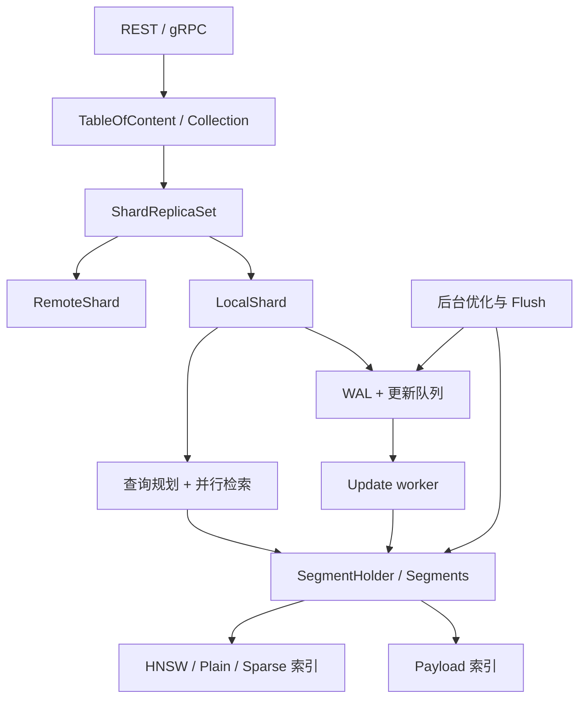
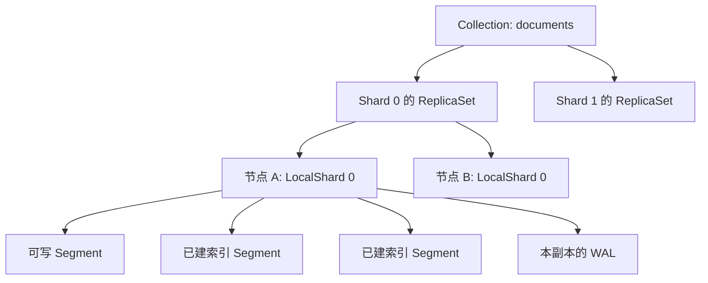
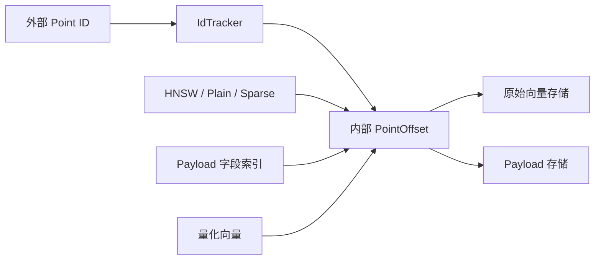
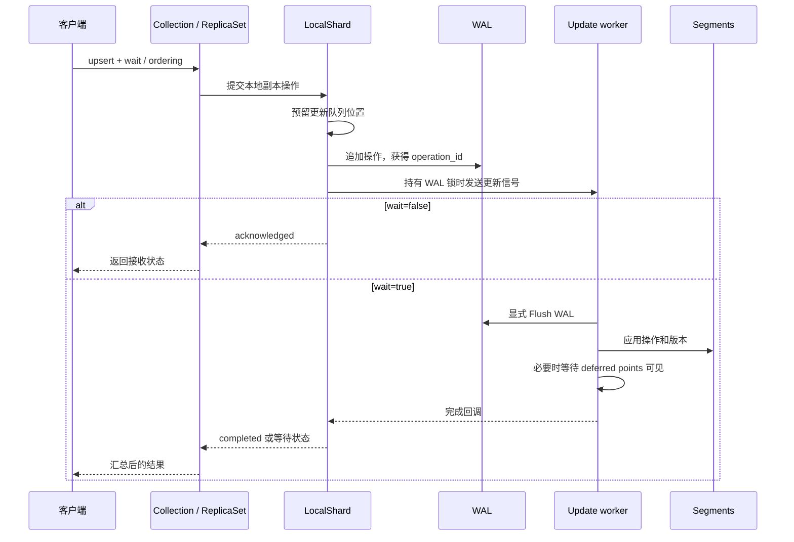
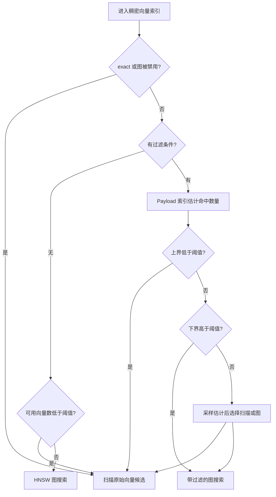
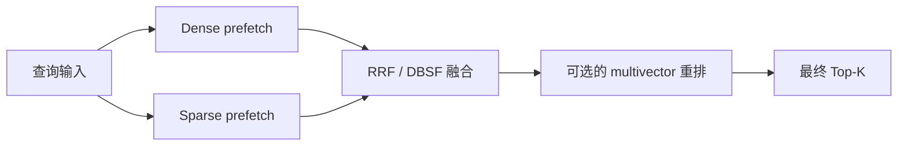
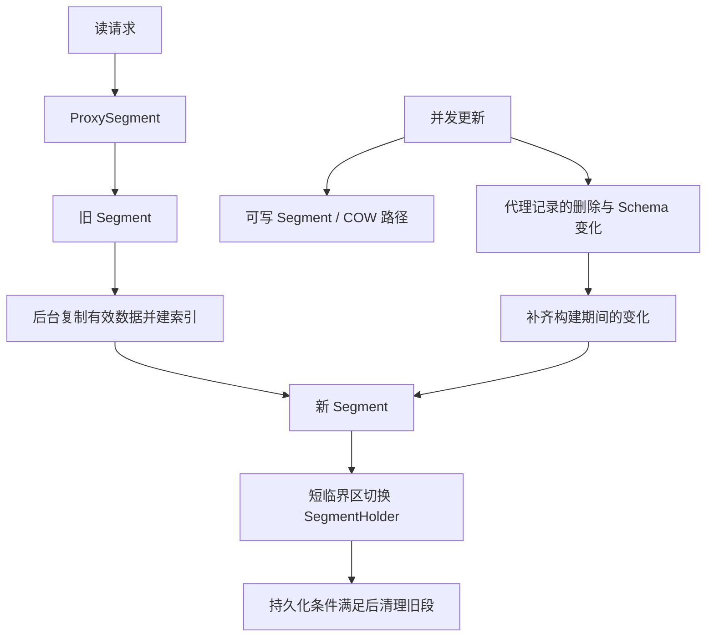
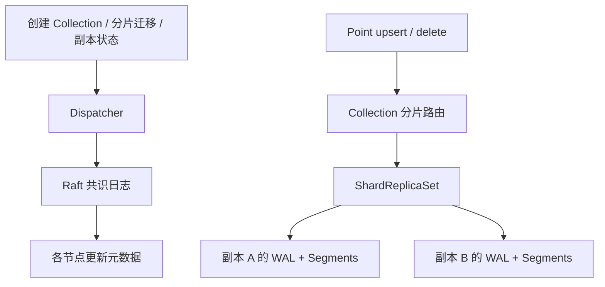

# Qdrant 设计与实现

整理日期：2026-10-14。源码基准：本地 [Qdrant 仓库](/Users/taiyou/project/opensource/qdrant)，提交 [016542aa5deb](https://github.com/qdrant/qdrant/commit/016542aa5deb6c66380bb137badf73d54f742bde)，提交日期 2026-10-05，根 `Cargo.toml` 版本为 **1.19.2**。

本文以这份源码的服务端路径为主，沿数据结构、写入、检索、优化、恢复和分布式调用链解释设计。官方在线文档用于交叉核对概念，可能随版本更新；实现与默认值以固定提交为准。本次没有编译、启动 Qdrant，也没有执行 Rust 测试、集群故障实验或性能测试。文中数字示例是说明原理的假设，不是实测结果。

<a id="overview"></a>

## 1. 先理解它要解决什么问题

**Qdrant 的核心是：把“带条件的相似度检索”做成一个可持续写入、可恢复、可横向扩展的数据库。** HNSW 负责缩小需要计算距离的范围；Payload 索引帮助找出符合条件的数据并选择执行路径；Segment、WAL 和后台优化负责让索引在不断变化的数据上继续工作。

只实现“给一批向量找最近邻”还不够。真实查询通常类似：

> 在租户 `acme` 的中文技术文档中，找出与“如何恢复数据库备份”最相关的 10 个片段；同时系统还在插入新文档、删除旧文档和构建索引。

这至少带来四组互相牵制的要求：

| 要求 | 直接实现的问题 | Qdrant 的主要处理方式 |
| --- | --- | --- |
| 搜索快、召回率高 | 全量距离计算准确，但代价随数据量增长 | HNSW 近似检索，小候选集仍可直接扫描 |
| 支持复杂过滤 | 先取向量 Top-K 再过滤，可能一个结果都不剩 | Payload 索引、基数估计、过滤感知的图搜索 |
| 写入及时、索引紧凑 | 每次写入都重建大索引，延迟无法接受 | 可写 Segment 接收变化，后台重建和合并 |
| 故障恢复、分布式扩展 | 内存索引不能解决宕机、复制和迁移 | WAL、版本、快照、Shard ReplicaSet、元数据共识 |

下面是全文的主线，箭头表示数据或控制关系，不表示所有操作同步完成。



可以把它理解为两条相互配合的路径：**写入路径先可靠地记录变化，再把变化应用到数据；读取路径根据数据形态和过滤条件选择最合适的检索方式。** 后台优化不断调整数据形态，让前两条路径不必承担全部维护成本。[写入入口][local-update]、[检索分派][hnsw-dispatch]、[优化执行][optimize]

| 想先弄清楚的问题 | 阅读位置 |
| --- | --- |
| Collection、Shard、Segment 各是什么？ | [2. 数据模型与分层](#layers) |
| 数据具体怎样存储？ | [3. Segment](#segment) |
| 一次 upsert 到底何时算完成？ | [4. 写入链路](#write) |
| HNSW 为什么快，过滤为什么难？ | [5. 索引与过滤](#index) |
| 查询、稀疏向量和混合检索怎样执行？ | [6. 查询链路](#query) |
| 持续写入时怎么重建索引？ | [7. 后台优化](#optimization) |
| 崩溃后怎么恢复？ | [8. 持久化与恢复](#recovery) |
| Raft 管什么，一致性参数管什么？ | [9. 分布式设计](#distributed) |
| 参数应该怎样理解和验证？ | [10. 参数与评估](#tuning)、[11. 源码阅读与测试](#verification) |

<a id="layers"></a>

## 2. 数据模型与分层：每一层解决不同尺度的问题

### 2.1 Point 是逻辑记录，向量与 Payload 各有职责

一个 Point 可以简化为：

```text
Point
├── id：对外标识，例如整数 ID 或 UUID
├── vectors
│   ├── text_dense：稠密向量
│   ├── text_sparse：稀疏向量
│   └── late_interaction：可选的 multivector
└── payload：业务属性，例如 tenant_id、language、doc_type、source_id
```

**向量回答“有多相似”，Payload 回答“是否满足条件”。** Point ID 用于精确定位记录。Payload 存储承载原始属性，Payload 索引是对选定字段构建的加速结构；保存了 JSON 字段，并不意味着已经为该字段创建索引。

Collection 定义向量配置、距离函数、分片与副本等设置。Named vectors 允许同一个 Point 包含多种表示，不同名称可以采用不同维度和距离函数。因此，不能把旧的“一个 Collection 只有一种固定长度向量”当成完整的数据模型。同一向量名称仍须满足对应配置；Payload 字段索引有类型，Payload 本身不是关系表那样固定的列集合。[Segment 配置和类型][types]、[REST 查询转换][query-api]

### 2.2 Collection → Shard → ReplicaSet → Segment

这里最容易混淆的是“切分数据”和“复制数据”。

| 概念 | 解决的问题 | 关键性质 |
| --- | --- | --- |
| Collection | 一组可共同查询的数据及其配置 | 对外的主要管理边界 |
| Shard | 数据量和处理能力的水平切分 | 不同 Shard 通常持有不同 Point |
| ShardReplicaSet | 一个逻辑 Shard 的副本协调 | 同一批数据可以有多个节点副本 |
| LocalShard | 当前节点上的一个分片副本 | 拥有本地 WAL、更新工作线程和 Segments |
| Segment | 本地存储与索引维护单元 | 每个 Segment 有自己的向量、Payload、ID 映射和索引 |



一个大 Collection 不会只有一张跨所有机器的 HNSW 图。图属于具体 Segment 的某个向量名称；查询需要在相关 Segment 和 Shard 中检索，再合并候选。[Segment 结构][segment-struct]、[Segment 检索协调][segment-searcher]、[跨分片查询][collection-query]

### 2.3 源码怎样对应这些层

| 位置 | 主要职责 |
| --- | --- |
| [src/main.rs][main] | 加载设置，构造 TableOfContent、Dispatcher、共识组件，启动 HTTP/gRPC 服务 |
| [src/actix/api][query-api]、[src/tonic][tonic] | REST 和 gRPC 协议入口、鉴权、参数转换 |
| [lib/storage][toc-points] | Collection 管理、访问检查、元数据操作与共识衔接 |
| [lib/collection][collection-write] | 分片路由、副本协调、服务端异步查询、更新和恢复 |
| [lib/shard][shard-lib] | SegmentHolder、更新操作、优化执行、查询公共结构等分片内部能力 |
| [lib/segment][segment-struct] | 单个 Segment 的存储、索引、过滤、距离计算与版本处理 |
| [lib/sparse][sparse-search]、[lib/quantization][quant-lib] | 稀疏倒排检索、向量量化算法 |
| [lib/wal][wal-lib]、[lib/common][common-lib] | WAL 底层及通用并发、I/O、资源与计量组件 |

**需要沿真实调用跳转，不能只按目录名推测。** 当前 `collection_manager/optimizers/segment_optimizer.rs` 已经只是对 `shard::optimizers` 的兼容再导出，而服务端的 `SegmentsSearcher` 仍在 `lib/collection`。这说明抽离分片公共能力是渐进的，不是一次性把所有 Shard 逻辑搬进新 crate。[兼容导出][optimizer-reexport]、[Segment 检索协调][segment-searcher]

<a id="segment"></a>

## 3. Segment：把存储、索引与维护范围限制在局部

### 3.1 一个 Segment 内部有哪些结构

`Segment` 的字段直接体现了设计：`id_tracker`、`vector_data`、`payload_storage`、`payload_index`，以及版本、持久化状态和可追加标志。每个 `VectorData` 又包含原始向量存储、向量索引和可选量化向量。[结构定义][segment-struct]



对外 ID 需要稳定，对内访问需要紧凑。通过 ID 映射，图的邻接表、删除位图、向量数组和倒排表可以使用内部偏移，减少反复处理 UUID 或外部 ID 的开销。Point 从一个 Segment 迁到另一个 Segment 时，外部 ID 不变，内部偏移可以改变。[ID 映射接口][id-tracker]

**数据与索引分开意味着：暂时没有 HNSW，也可以检索。** Plain 索引能够遍历原始向量，Payload 索引也可以先给出候选 ID，再计算距离。因此索引构建可以从用户请求中移到后台；代价是未优化阶段的检索可能更慢。[向量索引构造][vector-index]、[HNSW 检索分派][hnsw-dispatch]

### 3.2 可追加 Segment 与已优化 Segment

可追加 Segment 承接新增数据。已优化 Segment 通常拥有更紧凑的存储与 HNSW 等结构；当底层不支持原地更新时，更新路径可以把 Point 迁移到可写 Segment，并处理旧位置的删除状态。这里的“不可追加”不等于任何状态都不可变：删除标记、Payload 索引 Schema 等仍有专门更新路径。[写入实现][upsert]、[SegmentHolder][segment-holder]、[版本跟踪][version-tracker]

这样设计的收益是把两种工作分开：

- 前台维护可写数据和必要的版本、删除状态，保证持续接收更新。
- 后台批量复制数据、构建索引、合并小段、回收失效空间。

它与 LSM 系统“前台接收变化、后台整理数据”的思路相近，但不能直接等同于经典的 MemTable/SSTable 分层：Qdrant 的 Segment 是可独立执行向量与过滤查询的单元，HNSW 构建、Payload 索引和向量布局都参与优化决策。

### 3.3 当前版本的存储不能再按旧的 RocksDB 图解理解

当前向量存储构造器遇到旧 `VectorStorageType::Memory` 会明确报错，指出该版本不再支持 RocksDB。实际分支包括连续或分块的 mmap 存储，以及把向量内联到图文件的存储；稀疏向量也有自己的存储路径。[向量存储构造][vector-storage]

Payload 的当前构造器使用 `PayloadStorageImpl`，可以根据平台与配置选择 mmap 或 Linux 的 io_uring 路径。不能据此把所有数据都描述成“保存在 RocksDB 中”，也不能反过来认为 mmap 就是不持久化。[Payload 存储构造][payload-storage]

本版本新增或强化了统一的 `Memory` 表达：

| 选项 | 含义 | 代价与边界 |
| --- | --- | --- |
| `cold` | 不预热，需要时从磁盘读取或调页 | 首次访问与随机 I/O 更敏感；访问后仍可能进入缓存 |
| `cached` | 启动时预热，使用可被回收的缓存 | 需要考虑预热时间和内存压力下的缓存淘汰 |
| `pinned` | 对支持此形态的组件使用常驻内存布局 | 必须容纳于 RAM；具体实现与支持范围依组件而定 |

`memory` 与旧 `on_disk` 同时出现时，显式 `memory` 优先。旧 `on_disk=false` 也不是所有组件都映射为同一种布局：普通向量路径常对应 `cached`，拥有堆内存实现的 Payload 字段索引、Sparse 索引可能映射到 `pinned`。[Memory 定义与转换][memory-types]、[优化器配置解析][optimizer-config]

**因此，“数据在磁盘上”与“查询时是否消耗 RAM”是两回事。** mmap 数据仍可能大量驻留于操作系统 Page Cache。向量、图、Payload、Payload 索引和量化副本的放置也应分别分析，不能用一个 `on_disk` 开关概括整个 Collection。

<a id="write"></a>

## 4. 写入链路：先记录可重放的操作，再更新 Segment

### 4.1 从 REST upsert 到本地更新线程

以普通按 ID upsert 为例，主要调用链为：

```text
PUT /collections/{collection_name}/points
  → actix::api::update_api::upsert_points
  → common::update::do_upsert_points
  → TableOfContent::update
  → Collection::update_from_client
  → ShardHolder::split_by_shard
  → ShardReplicaSet::update_with_consistency
  → LocalShard::submit_update / append_and_dispatch
  → RecoverableWal::lock_and_write + UpdateSignal::Operation
  → UpdateWorkers::update_worker_fn
  → CollectionUpdater::update
  → shard::update → SegmentHolder → Segment
```

入口承担请求转换、访问及严格模式等检查；Collection 根据 Point ID 和 Shard key 路由；ReplicaSet 处理副本写入和顺序要求。本地副本才进入 WAL 与 Segment 更新路径。[REST 写入口][update-api]、[通用 upsert][common-update]、[ToC 更新][toc-points]、[Collection 写路由][collection-write]



图中未画出其他副本；即使 `wait=false`，后台更新线程仍会继续消费操作。

### 4.2 为什么队列顺序必须与 WAL 顺序一致

`append_and_dispatch` 先预留 channel 容量，再写 WAL，并且**持有 WAL 锁直到更新信号送入队列**。否则两个并发请求可能按 A、B 的顺序写日志，却按 B、A 的顺序被更新线程处理。恢复重放与正常运行就会得出不同的状态。[提交实现][local-update]

队列过长时，信号可以只保留操作号，更新线程再从 WAL 读取操作内容，减少 RAM 中重复保存大量向量和 Payload 的压力。它不是跳过更新，而是改变排队数据的承载位置。[提交实现][local-update]、[更新线程][update-worker]

这一点体现了 WAL 的第二个价值：它既是恢复依据，也能承担积压操作的磁盘缓冲。

### 4.3 按过滤条件更新，为什么不能原样记进 WAL

考虑一个删除请求：删除 `status="expired"` 的所有 Point。如果日志只记这个过滤条件，重放时数据状态已经不同，可能匹配另一批 Point。

本版本的 `submit_update_filter_resolving` 专门解决这个问题：

1. 获取更新提交的写锁，阻止新操作插入这个临界区。
2. 向更新队列放入 `Plunger`，等待此前已经追加的操作应用完毕。
3. 在这个确定的状态上，把过滤或条件操作解析为具体 Point ID 的操作。
4. 将解析结果作为一个 WAL 记录追加并送入队列，然后释放锁。

**持久化的是本次实际操作的对象，而不是未来重新解释一次查询条件。** 这使正常运行和恢复重放使用同一组目标。[过滤操作提交][resolve-submit]

解析发生在各副本本地，源码的前提是“持有相同数据的副本解析得到相同集合”。它没有因此提供跨副本的全局快照事务；副本状态、顺序和一致性仍由分布式路径处理。该路径也有额外的排队等待、扫描及大 ID 集合成本。

### 4.4 `acknowledged`、`completed` 和查询可见不是一个概念

当前内部 `WaitUntil` 有三个层次：

| 层次 | 等待内容 | 使用边界 |
| --- | --- | --- |
| `Wal` | 操作已追加到 WAL 并提交给更新队列 | 公共 `wait=false` 映射到此；不等待 Segment 应用 |
| `Segment` | 更新线程已把操作写入 Segment | 内部路径可用；存在 deferred points 时不一定可见 |
| `Visible` | 应用完成，必要时等待延迟数据可见 | 公共 `wait=true` 映射到此 |

在普通配置下，新数据可以通过可写 Segment 的扫描路径参与查询，不必先拥有 HNSW。启用 `prevent_unoptimized` 后，部分数据会延迟到优化后才可见；此时 `Visible` 等待会更长。代码把这段等待分离出去，让更新队列可以继续处理后续操作。[WaitUntil][wait-until]、[更新与可见性等待][update-worker]

还有三个实际边界：

- `acknowledged` 不能直接解释成“所有 Segment 文件都已刷盘”。这条返回路径没有等待逐请求 WAL Flush；有回调的等待路径才在应用前显式 Flush WAL。
- `completed` 是所选写入和等待条件完成，不等于所有副本在同一时刻都能给出完全相同的搜索结果。
- `wait_timeout` 不表示操作已回滚。客户端等待结束后，后台操作仍可能继续；应处理未知结果，而不是把超时当成“没有写入”。

依据：[等待返回状态][local-update]、[WAL Flush 与更新][update-worker]、[副本结果合并][replica-update]。

### 4.5 版本与更新语义

本地 WAL 操作号用作更新序号，Segment 与 Point 保存相关版本。Point 更新会检查已有版本，避免旧操作覆盖较新状态；搜索结果聚合也利用版本排除已返回候选中的旧副本，并按外部 ID 去重。这些机制服务于重放、迁移和并发维护，不是供用户任意历史时间点查询的 MVCC 快照接口。[Point 版本检查][point-version]、[结果聚合][search-aggregator]

还应区分整点替换和局部更新：本版本 upsert 的公共内部实现明确按“整个 Point 替换”处理，旧向量和 Payload 不会自动合并保留。仅更新部分内容，应理解相应的 vectors 或 payload 更新操作。[upsert 实现][upsert]

<a id="index"></a>

## 5. 索引设计：真正的难点是向量搜索与过滤共同工作

### 5.1 先有距离计算，再谈索引

给定查询向量 `q` 和候选向量 `x`，检索需要用指定距离或相似度函数打分。无索引时，对 N 个 d 维稠密向量直接扫描，主要计算量随 `N × d` 增长。

Qdrant 支持 Cosine、Dot、Euclid、Manhattan 等度量。以 Cosine 为例，当前实现通过预处理归一化向量，把相似度计算转成点积，并在适用平台使用 SIMD 路径。[距离计算][metrics]

这说明两件事：Embedding 模型决定向量表达什么，距离函数决定怎样比较这些表达；索引主要改变“访问哪些候选”，不会自动修复不合适的 Embedding 或数据切分。

### 5.2 HNSW：上层找方向，底层扩展候选

HNSW 把向量作为图节点，把近邻关系作为边，组织成多层图。少量节点出现在更高层，上层图帮助快速靠近目标区域；底层保留更完整的局部连接。

典型搜索分两部分：

1. 在高层从入口开始贪心前进，找到更接近查询的位置，再逐层下降。
2. 在底层维护待探索候选与当前最佳结果集合，访问近邻并更新结果，直到继续探索难以改善当前集合。

当前实现的 `graph_layers.rs` 明确区分了高层入口贪心搜索和单层 beam search，使用 visited 结构避免重复探索。[图搜索实现][graph-search]

| 参数 | 控制什么 | 调高通常意味着什么 |
| --- | --- | --- |
| `m` | 图的连接预算 | 更多连通路径，也增加图大小和构建、访问成本 |
| `ef_construct` | 构建时考虑的候选范围 | 有机会构建更好的邻接关系，但建图更贵 |
| `hnsw_ef` | 查询时的探索范围 | 通常提升召回机会，同时增加距离计算与 I/O |

`ef` 不是返回条数；Top-K 是结果数量，`ef` 是探索预算。实际搜索还会结合 Top-K、量化过采样等确定有效探索范围。[搜索参数使用][hnsw-search]、[HNSW 配置][hnsw-config]

HNSW 的收益来自少访问大量无关向量，因此是近似搜索。它不保证每次得到精确 Top-K，也不能把实际复杂度在所有分布和过滤条件下都概括成固定的 `O(log N)`。

### 5.3 为什么“先向量 Top-K，再过滤”不可靠

假设全库 100 万条，其中只有 1,000 条属于当前租户。先找全库 Top-10，再删除其他租户的数据，即使过滤本身完全正确，也可能没有剩余结果；真正的租户内 Top-10 根本没有进入候选集。

另一个方向是先取出租户内所有 ID，再逐个计算距离。如果只有 20 条，这非常划算；如果还有 50 万条，扫描代价仍然很高。

更棘手的是直接在 HNSW 遍历中剔除不符合条件的节点：有些节点虽然不能作为结果，却是连接图中两个区域的通路。过滤后图可能变得难以遍历，造成召回下降。

因此 Qdrant 组合了三个方法：**估计候选数量、根据数量选择扫描或图搜索、改善过滤条件下的图连通性。**

### 5.4 Payload 索引同时是过滤工具和估算工具

Payload 索引围绕字段类型建立专门结构，例如 keyword 等值匹配、数值范围、地理条件和全文条件。它主要提供三类能力：

- 根据条件枚举可能命中的内部 ID。
- 为某个 ID 快速判断是否满足条件，尽量避免读取完整 Payload。
- 返回过滤命中数量的估计，为执行路径选择提供依据。

`optimize_filter` 会把条件转换成检查器，尽量使用字段索引，并根据基数估计重排条件。比如 AND 条件通常可以先检查更容易失败的部分，从而少做后续检查。[Payload 过滤优化][payload-optimizer]、[Payload 读接口][payload-read]

这里的基数指“符合条件的 Point 数量”，不是向量维度。估计包含下界、期望值、上界等信息；多个条件组合后，不一定能准确知道它们之间的相关性，因此不能把估计当成精确计数。

### 5.5 查询分派：小集合扫描，大集合走图，中间再采样

`HNSWIndexReadView::search` 中的逻辑可以概括如下。这是**单个 Segment、具体向量索引内部**的选择，不是全 Collection 统一选择一次。[执行分派][hnsw-dispatch]



`exact=true` 的这条稠密检索路径会绕开 HNSW，并关闭可选的量化搜索表示，扫描配置中保存的向量数据。若原始存储本身使用低精度 datatype，`exact` 并不会把已经损失的精度恢复成最初输入的 float32。

`full_scan_threshold` 的外部配置以 KB 表达。构造内部图配置时，代码用平均向量字节数把它换算为向量数量，再与估计基数比较。不能直接把 `10000` 解释为 10,000 个 Point。[阈值换算][hnsw-threshold]

同样，“扫描路径”不一定代表扫描整个 Segment：有可用的过滤索引时，可以先枚举匹配 ID，只计算这部分向量。

### 5.6 Filterable HNSW 与 ACORN 分别补什么

Filterable HNSW 在建图阶段利用已建立索引的 Payload 字段，把某些 Payload block 内的节点建立额外连接，再合入图中。这样，某类过滤会保留的点之间有更多可用通路。[额外边构建][hnsw-payload-links]

这也解释了为什么 Payload 索引创建时机影响向量检索：额外边的构建依赖字段索引。后加字段索引，并不等于所有既有图瞬间完成重建。`enable_hnsw=false` 可让某个字段保留过滤索引，却不为其构建 HNSW 额外边。额外边需要额外空间和构建时间。[官方索引说明](https://qdrant.tech/documentation/manage-data/indexing/#filterable-hnsw-index)

但为字段 A 和字段 B 分别加边，不代表已经为所有 `A AND B` 组合建好了图。ACORN 在搜索时进一步探索被过滤邻居周围的二跳邻居，以改善这类连通性问题；代价是额外访问。当前代码只在请求启用 ACORN、满足过滤选择比例等条件时采用它，并非所有过滤查询默认都用 ACORN。[算法选择][hnsw-dispatch]、[ACORN 遍历][graph-search]

一个具体例子有助于理解三者关系：

- 过滤后只剩 20 条：直接打分通常最简单，HNSW 的导航开销可能得不偿失。
- 过滤后仍有几十万条：借助图缩小距离计算范围更有价值。
- 中等数量、组合过滤切断大量边：额外边和可选 ACORN 尝试改善导航，但最终仍应测量过滤条件下的召回率。

### 5.7 量化：把便宜的筛选与昂贵的精算分开

量化把向量表示压缩，降低存储带宽、内存和候选打分成本。当前配置包括 scalar、product、binary 等量化族，具体编码与支持范围由类型和实现决定。[量化配置][quant-types]

| 方法 | 基本思路 | 主要取舍 |
| --- | --- | --- |
| Scalar | 把单个维度映射到较少的数值等级 | 实现和打分较直接，但引入数值误差 |
| Product | 把向量拆成子空间，用码本表达各子向量 | 更高压缩空间，增加训练码本和查表成本 |
| Binary | 用非常紧凑的位编码近似向量关系 | 压缩显著，适用性更依赖向量分布和编码方式 |

搜索可以先用量化向量取出比最终 K 更多的候选，再用保存的原始向量重新打分并截取 Top-K。`oversampling` 控制扩大的候选数量，`rescore` 控制是否精算；是否默认重打分取决于量化实现，不应统一写死。[量化搜索后处理][quant-search]

重打分只能改善**已经召回的候选**之间的排序，不能找回被图搜索或量化筛选完全漏掉的 Point。还要区分“HNSW 近似误差”“量化误差”和“Embedding 本身的相关性不足”，三者不是同一个问题。

<a id="query"></a>

## 6. 查询链路：从统一请求到分片、Segment 和多阶段检索

### 6.1 一次带过滤的稠密查询怎样执行

下面是一个说明结构的请求，假设 Collection 已配置名为 `text_dense` 的三维向量。三维值仅作示例，不是用于真实文本语义检索的模型输出。

```http
POST /collections/documents/points/query
Content-Type: application/json

{
  "query": [0.2, 0.5, 0.1],
  "using": "text_dense",
  "filter": {
    "must": [
      {"key": "tenant_id", "match": {"value": "acme"}},
      {"key": "doc_type", "match": {"value": "technical"}}
    ]
  },
  "params": {"hnsw_ef": 128},
  "limit": 10,
  "with_payload": ["source_id", "title"]
}
```

执行过程可以沿源码分成六步：

1. **协议转换。** REST 请求转换为 `CollectionQueryRequest`，执行访问与严格模式相关检查。请求如果使用文档或其他推理输入，还会涉及入口的 inference 转换；已提供向量的请求不需要因此重新生成 Embedding。
2. **Collection 解析。** 将“用某个 Point 的向量查询”等引用解析成实际向量，构造 `ShardQueryRequest`，选择目标 Shard。
3. **副本选择。** 每个 Shard 的 ReplicaSet 按读一致性、可用性及路由等条件执行本地或远程读取。
4. **本地计划。** `LocalShard` 构建 `PlannedQuery`，把底层 search、scroll 和后续合并、重打分阶段组织起来。
5. **Segment 执行。** `SegmentsSearcher` 并行搜索 Segment；各自的向量索引按前文逻辑选择扫描或图搜索，返回候选。
6. **结果合并。** 按版本及 ID 处理 Segment 候选，完成分片和 Collection 层合并，执行需要的最终融合、分页与结果字段填充。

依据：[REST 查询][query-api]、[查询类型转换说明][query-types]、[Collection 查询][collection-query]、[LocalShard 执行计划][local-query]、[Segment 检索协调][segment-searcher]。

### 6.2 Top-K 合并为什么还需要补查

最直接的方法是向每个 Segment 都索取 K 个候选，然后合并。Segment 很多时，会计算和传输大量最终用不到的结果。

`SegmentsSearcher` 有基于数据分布的候选数量采样：先让部分 Segment 返回较少候选；合并后比较分数边界，如果某个 Segment 仍可能贡献遗漏的结果，就对它重新搜索。跨 Shard 查询也有自己的候选缩减及检查逻辑，其网络补查成本不同。[Segment 采样与重查][segment-searcher]、[Shard 查询合并][collection-query]

这是一种减少过量取回的执行优化，不是“HNSW 已经变成精确检索”的证据。底层近似检索误差仍然存在。

`offset` 也有代价：底层经常需要处理 `limit + offset` 数量的候选，而不是只处理最终返回条数。深分页会扩大计算与中间结果；批量导出数据应理解 scroll 的语义，不能把相似度排序分页当成廉价游标。[搜索批参数][shard-search]

### 6.3 Sparse：倒排表利用的是稀疏性，不是图导航

稀疏向量只保存非零维度，例如：

```text
q = {12: 0.8, 93: 0.4}

倒排表 12 → [(point 5, 0.7), (point 8, 0.2), ...]
倒排表 93 → [(point 5, 0.6), (point 9, 0.9), ...]
```

查询只访问涉及维度的 posting lists，为同一 Point 累积各维度乘积。主计算不需要沿 HNSW 图导航。实现维护 Top-K 阈值，并在适用条件下利用剩余权重上界跳过不可能改善 Top-K 的部分。[Sparse SearchContext][sparse-search]

上界剪枝依赖数学前提。当前实现明确检查查询权重是否非负，以及 posting list 是否提供可靠的 `max_next_weight`；不满足时不能套用同一种剪枝。Sparse 索引也会利用 Payload 条件，候选很少时可以走过滤后的直接打分路径。[Sparse 索引分派][sparse-dispatch]

不要把 Sparse 与 BM25 完全等同：Sparse 是表示和检索结构，BM25 是一种文本打分方法，学习型稀疏模型也可以产生 Sparse 向量。当前仓库包含独立 `lib/bm25`，将词项转换为稀疏权重；查询上下文还支持按配置施加 IDF。Payload 全文过滤索引又是另一种能力，不能因为存在全文字段索引，就认定所有查询已经执行 BM25 排序。[BM25 实现][bm25]、[Sparse 查询与 IDF][sparse-dispatch]

### 6.4 Hybrid Query：先分别召回，再融合或重排

统一 Query API 的 `prefetch` 可以描述多路候选及后续阶段。一个常见的结构是：



这不是把两个分数随手相加。Dense 相似度与 Sparse 分数通常不处于同一个尺度：

- **RRF** 使用各召回列表中的名次，减少原始分数尺度不一致的问题。
- **DBSF** 先根据各列表的分数分布归一化，再聚合同一 Point 的贡献。
- **向量重打分** 对前面召回的候选用另一种向量表示计算得分。

当前无权重 RRF 实现的单路贡献是 `1 / (position + k)`，`position` 从 0 开始，默认 `k=2`；有权重时使用不同的名次缩放公式。不能从别的框架照搬 `k=60` 并当成本版本默认值。[RRF 实现][rrf]、[DBSF 实现][dbsf]

分布式执行尤其需要注意融合层次。源码让根查询的 Fusion 在汇总跨 Shard 的中间列表后完成；嵌套 prefetch 也可以在本地执行其阶段。RRF 依赖名次，不能不加区分地把“各 Shard 融合后的分数”再次当成原始召回分数相加。[本地递归计划][local-query]、[Collection 最终融合][collection-query]

最后一个阶段的效果受前级候选限制：前面只取 20 个候选，后面再强的重排也看不到第 21 个之外的数据。Prefetch limit、过滤条件和最终 offset/limit 应作为整条流水线一起设计。[查询计划][planned-query]

### 6.5 Multivector：用一组局部表示保留更细的匹配信息

单个向量把整个片段压缩成一个表示；Multivector 可以为一个 Point 保存多个向量，例如文本 token 的表示。当前 `MaxSim` 评分的核心是：

```text
score(Q, D) = 对每个查询子向量 qi 求和：max_j similarity(qi, dj)
```

每个查询子向量先在文档子向量中找到最佳匹配，再累加。这适合表达局部词项或片段的匹配关系，但计算量和存储量也随子向量数量增长。因此，把它用于前级召回后的有限候选重排，是由计算成本自然导出的设计方式，不代表它只能用于重排。[MaxSim 实现][maxsim]

<a id="optimization"></a>

## 7. 后台优化：在线服务时怎样重新组织数据

### 7.1 Optimizer 不是 SQL 查询优化器

本文有两种“优化”：查询分派决定**本次请求如何读取**；Segment Optimizer 决定**已有数据如何重新组织**。后者会执行实际的数据复制和索引构建。

| 优化器 | 观察的问题 | 处理方式 |
| --- | --- | --- |
| Merge | Segment 太多，小段造成额外检索与管理开销 | 选择可合并段，构建较大的新段 |
| Indexing | 向量数据达到适合建索引或改变布局的规模 | 建 HNSW、量化或调整相关存储形态 |
| Vacuum | 删除或失效数据占比达到条件 | 重建有效数据，回收无效空间 |
| Config mismatch | Segment 形态与目标配置不一致 | 通过重建使旧数据逐步符合新配置 |

优化器负责选择任务，通用执行逻辑在 `shard::optimize` 中；执行还受线程、CPU、I/O、磁盘空间及取消信号约束。[优化器定义][optimizers]、[执行框架][optimize]

### 7.2 为什么不能把旧 Segment 锁住后慢慢重建

构建大图可能耗时很长。若一直持有写锁，会阻塞更新；若完全不协调，构建期间发生的删除和更新就会丢失。

Qdrant 的办法是用 ProxySegment 包装正在优化的旧段。读请求继续使用旧段与代理维护的状态；写入通过可写段承接，删除、索引与向量名称等变化由代理记录。必要时创建额外的可写临时段。[Proxy 与执行入口][optimize]



这个过程可以概括为：

1. 确认输入段还存在、尚未被其他优化接管，检查空间和资源预算。
2. 包装旧段，并保证还有可写目标承接并发更新。
3. 在较少持锁的阶段复制数据、构建新索引。
4. 把构建期间记录的变化应用到新段；收尾时阻止变化继续越过切换边界。
5. 把新段替换进 SegmentHolder，更新 manifest。
6. 保留旧段和恢复所需 WAL，直到 Flush 证明相关状态可安全恢复，再清理旧段。

依据：[优化执行][optimize]、[Segment manifest][manifest]、[Flush 与清理协调][holder-flush]。

### 7.3 切换成功不等于旧文件可以立即删除

假设 Point 已从旧段迁到新位置，但新位置尚未刷盘。此时立刻删除旧文件，再截断相应 WAL，崩溃后既没有旧数据，也没有足够的重放依据。

当前 `finish_optimization` 对此有明确保护：在切换前保存新段版本标记；切换后登记旧段的延迟删除及 WAL acknowledge 限制；先更新 manifest，再在后续持久化条件满足后回收旧文件。测试还专门模拟切换后的失败，检查恢复所需状态没有被提前释放。[优化收尾与故障测试][optimize-finish]

所以“后台重建”的复杂度主要不在把一份向量复制成另一份，而在于**同时保住在线查询、并发变化与崩溃恢复这三个条件**。

### 7.4 Segment 大小是一项持续的取舍

大 Segment 减少跨段扇出和合并，却增加一次建图、重建及故障恢复的工作量；小 Segment 更容易逐步维护，但查询会访问更多独立索引。后台优化还要与前台搜索竞争 CPU、内存和磁盘带宽。

这解释了为什么 Qdrant 同时提供 Segment 数量、大小、建索引阈值、索引构建线程和优化任务并发等参数。把它们全调大，不能同时解决所有问题。[优化配置][optimizer-config]、[服务端默认配置][config]

<a id="recovery"></a>

## 8. 持久化与恢复：日志、数据文件、版本和快照共同构成恢复链

### 8.1 WAL 保护增量，Segment 文件承载当前数据

本地副本的核心恢复关系是：

```text
已持久化的 Segment 状态 + 尚需重放的 WAL 操作 → 可恢复的分片状态
```

更新完成不要求每次都同步刷完所有 Segment 文件。后台 Flush worker 先 Flush WAL，再获取已应用操作边界，Flush 各 Segment，计算安全的已持久化位置，结合失败操作和 WAL pins 限制可 acknowledge 的范围。[Flush worker][flush-worker]

这里有两个容易忽略的细节：

- Flush 与更新并发运行，不能把只应用了一半的操作当成完整持久化。代码用 `applied_up_to` 限制本轮能确认的版本。
- 快照或迁移可能仍需要较早的日志；即使数据已刷盘，WAL pin 也会阻止截断到这些位置之后。

因此 WAL 清理不是“过了五秒就把旧日志删掉”，而是由数据持久化进度及仍然依赖日志的工作共同决定。[Flush worker][flush-worker]、[Segment Flush][holder-flush]

### 8.2 启动恢复不只是读取一个向量文件

`LocalShard` 加载过程会恢复 Segment、处理代理残留的 pending changes，随后执行 `load_from_wal`。WAL 重放重新调用更新逻辑，由版本检查避免旧操作覆盖新数据；`prevent_unoptimized` 等配置还会影响剩余操作恢复与排队的方式。[本地分片加载][local-shard]、[WAL 恢复入口][wal-recovery]

| 中断发生的位置 | 恢复需要什么 |
| --- | --- |
| 操作尚未写入 WAL | 不能从这条路径承诺它已被接收 |
| WAL 已持久化，Segment 尚未应用或刷盘 | 重新加载已有段并重放保留日志 |
| 某些 Segment 已 Flush，另一些尚未完成 | 依靠安全版本边界保留足够 WAL，避免过早截断 |
| 优化中途失败或崩溃 | 保留旧段、代理变化日志及重放依据；未完成新段不能随意当成有效段 |
| 客户端超时，但写入仍在后台执行 | 需要确认结果或按可重试语义处理，不能假定服务端取消 |

该表描述源码采用的恢复机制，不是本次进行了上述故障注入并确认全部通过。

### 8.3 快照必须覆盖一个可恢复状态

直接复制正在变化的存储目录，不天然保证各文件来自兼容的状态。快照路径需要协调 Segment、WAL 和版本/时钟元数据。当前 WAL pin 的测试明确覆盖了“Segment 文件复制期间，所需日志不能被后台截断”的场景。[快照入口][snapshot]、[WAL pin 规则][flush-worker]

单个本地 Shard 或节点上的快照也不能自动代表“整个分布式 Collection 的所有分片”。副本复制解决在线数据冗余，快照与外部备份解决恢复历史状态和灾难恢复；误删除可能复制到所有副本，所以副本数不能替代备份。

### 8.4 为什么有版本号也不能直接宣称有事务数据库语义

版本用于内部重放、覆盖控制和合并，不代表用户获得跨 Point、跨 Shard 的原子提交或一致快照读取。写入分发给多个分片和副本后，一部分可能已成功，另一部分失败；错误结果不意味着所有已成功操作都已回滚。[Collection 写入结果处理][collection-write]、[副本失败处理][replica-update]

查询也存在阶段边界：本地查询在补充 Payload/vector 时明确处理“Point 在搜索与取回之间被删除”的情况。因此不能把一次多阶段搜索想象成关系数据库里锁定在某个时间点的事务快照。[结果字段填充][local-query]

<a id="distributed"></a>

## 9. 分布式设计：元数据共识与数据复制各司其职

### 9.1 Raft 决定集群如何组织，Point 写入走 ReplicaSet

最关键的区分是：**Qdrant 使用 Raft 协调集群和 Collection 元数据，但普通 Point 更新并不是逐条作为集群 Raft 日志提交。**



证据不只来自架构说明：`Dispatcher::submit_collection_meta_op` 在分布式模式向共识层提出操作；`ConsensusOperations` 包含 CollectionMeta、节点增删及相关集群状态；普通 Point 写入则沿前述 `update_from_client → update_with_consistency` 路径传播。[元数据 Dispatcher][dispatcher]、[共识操作类型][consensus-ops]、[元数据操作类型][meta-ops]、[Point 副本写入][replica-update]

这是吞吐和协调成本之间的选择：频繁的数据更新不必全部经过一个全局元数据共识序列；同时，数据读写需要自己的顺序、一致性、失败副本管理和恢复机制。

### 9.2 自动分片、定制分片与查询扇出

自动分片通过 Point ID 的哈希路由分配数据。源码的 `HashRingRouter` 支持普通单哈希环，以及 resharding 期间同时存在的 old/new 哈希环。[哈希路由][hash-ring]

Custom shard key 让应用按租户、时间段等业务维度选择一组分片。它可用于减少某类请求的查询范围，但需要管理数据分布和热点。Payload 中的 `tenant_id` 条件与请求的 shard key 不是同一个东西：有过滤条件，不代表路由层自动只访问某个专属 Shard。[Collection 写路由][collection-write]、[Shard 选择][shard-holder]

类似地，增加机器、副本数和 Shard 数解决不同问题：

| 改变 | 主要影响 |
| --- | --- |
| 更多 Shard | 数据与查询计算可以切分到更多分片，也增加扇出和协调开销 |
| 更多 replica | 增加数据冗余和可分摊的读取能力，也增加写入、空间和恢复成本 |
| 更多节点 | 提供更多可部署资源，但仍需把 Shard/replica 实际分配或迁移过去 |

### 9.3 写入的三个参数回答三个不同问题

| 机制 | 回答的问题 | 不等同于 |
| --- | --- | --- |
| `wait` | 每个写入调用等到哪个本地执行阶段？ | 全集群线性一致性 |
| `write_consistency_factor` | 副本写入结果需满足多少成功要求？ | Raft 多数派提交 |
| `ordering` | 并发写入经由谁来串行安排？ | 所有 Shard 的全局事务顺序 |

ReplicaSet 会尝试向相关副本发送更新，并依据成功、失败和副本状态判断结果。成功不足可能返回错误但已部分应用；成功达到要求时，失败副本仍需要被禁用和恢复。当前实现还限制成功阈值不超过参与副本数量，并要求存在可作为有效数据来源的成功副本，因此不应仅用一个裸数字概括全部判断。[副本更新汇总][replica-update]

`ordering` 的当前实现尤其值得直接看代码：

| 级别 | 更新协调者选择 | 取舍 |
| --- | --- | --- |
| `weak` | 当前接收这次更新的 peer | 不额外用统一 leader 串行化，吞吐和可用性较好，但并发顺序可能不同 |
| `medium` | 当前可作为数据来源的存活副本中最高 peer ID | 经选定节点并持锁安排写入；可用副本变化时协调者可能变化 |
| `strong` | ReplicaSet 中最高 peer ID | 使用稳定的指定协调者；该节点不可用时，这类写入可能不可用 |

这个 write leader 是副本写入路径的选择结果，**不是 Raft 元数据 leader 的同义词**。不同 Shard 有各自的 ReplicaSet，`strong` 也不意味着一个批次跨所有 Shard 原子完成。[协调者选择与写锁][replica-update]

### 9.4 读一致性：查询多少副本，以及怎样接受结果

以有 3 个正常副本的逻辑 Shard 为例：

| 参数 | 读取及合并规则 | 直观代价 |
| --- | --- | --- |
| `1`，默认 | 需要一个副本的结果 | 读取开销小，可能读到尚未传播的状态 |
| `2` | 需要两个副本的结果，按 All 条件解析 | 多一次副本读取，并要求所取结果一致 |
| `quorum` | 需要多数副本的结果，按 All 条件解析 | 3 副本时需要 2 个成功结果 |
| `majority` | 查询全部副本，按 Majority 条件解析 | 根据多数副本一致的结果返回，读取范围更大 |
| `all` | 查询全部副本，按 All 条件解析 | 条件最严格，也更依赖所有副本可用 |

这里以 `execute_read_operation.rs` 的实际 match 分支为准；`consistency_params.rs` 中部分注释把 `majority` 和 `quorum` 的说明写反，不能只引用该注释。官方当前文档与实际分支一致。实际发出请求的数量还可能受到读 fan-out 等执行策略影响，表格描述的是核心结果要求。[读执行实现][replica-read]、[官方一致性说明](https://qdrant.tech/documentation/scaling/consistency-guarantees/#read-consistency)

读一致性解决的是副本结果的接受条件，不保证 HNSW 的 ANN 召回等于精确答案。即使没有并发写入，不同副本的索引构建与优化时机也可能不同；业务正确性和向量检索质量需要分别验证。

### 9.5 故障副本怎样追赶数据

当前数据复制包含 `ClockTag` 和每个 peer/clock 的进度记录。它们帮助识别过旧的更新、处理重试，并表示副本恢复点；不是把各机器的本地 WAL 下标误当成全局统一版本。[副本时钟与更新][replica-update]、[RecoverableWal][recoverable-wal]

WAL delta transfer 的典型流程是：

1. 目标进入 Recovery 等受控状态，避免普通新写入破坏恢复顺序。
2. 获取目标恢复点，检查源副本是否仍保留需要的 WAL 范围。
3. 源副本使用 QueueProxy 排队恢复期间的新更新，传送旧差异并追赶积压。
4. 追赶后切到 ForwardProxy，让新更新继续送达。
5. 通过状态协调完成恢复和代理解除。

如果日志已不够、恢复点不兼容或差异不适合增量方案，就不能保证仅靠 WAL delta 恢复；系统还具备快照等迁移路径。[WAL delta transfer][wal-transfer]、[增量恢复边界][recoverable-wal]、[恢复回退测试][transfer-test]

这与后台 Segment 重建使用代理的思路相通：**先让旧状态继续服务，把变化暂存或转发，再完成新状态与变化流的衔接。** 一个处理本地索引更换，一个处理跨节点数据迁移。

<a id="tuning"></a>

## 10. 参数与评估：把成本放回实际路径中理解

### 10.1 两个相似的阈值控制不同事情

| 参数 | 所在阶段 | 作用 |
| --- | --- | --- |
| `indexing_threshold` / 配置文件中的 `indexing_threshold_kb` | 后台维护 | 判断数据规模是否值得构建向量索引 |
| `full_scan_threshold` / `full_scan_threshold_kb` | 单次检索 | 判断本次候选规模是否值得走图 |

一个段已经建有 HNSW，仍可能因为过滤后候选很少而扫描；一个段尚未建图，通常仍能通过 Plain 路径搜索。它们不是同一个“超过多少条开始用 HNSW”的开关。[Indexing optimizer][indexing-optimizer]、[查询分派][hnsw-dispatch]

本地 `config/config.yaml` 的示例/默认设置包含 `m=16`、`ef_construct=100`、两个阈值各为 `10000 KB`、`flush_interval_sec=5`。这些值可以被 Collection、命名向量或部署配置覆盖，不是对所有工作负载的推荐答案。[固定版本配置][config]

### 10.2 按现象找对应层

| 现象 | 优先核对的机制 | 不能直接下的结论 |
| --- | --- | --- |
| 小数据搜索没有使用 HNSW | 数据量、建索引阈值、过滤基数、`exact` | “索引坏了” |
| 加过滤后召回下降 | 字段索引、图额外边、组合条件、`hnsw_ef`、ACORN | “只要提高 limit 就能解决” |
| 写成功后某次搜索暂时找不到 | 返回 status、wait、deferred points、读取副本、过滤、ANN | “数据一定丢了” |
| 开启磁盘存储后仍用很多 RAM | Page Cache、图、Payload 索引、量化副本、优化峰值 | “on_disk 没生效” |
| 批量导入后 CPU 和磁盘持续繁忙 | 更新积压、Indexing/Merge、Flush、量化构建 | “前台请求结束后应该立刻空闲” |
| Hybrid 改善有限 | 各路候选覆盖、过滤一致性、prefetch limit、融合方法 | “融合算法保证更高相关性” |
| 节点恢复很慢 | WAL 保留、恢复点、快照/增量路径、追赶写入速度 | “有副本就一定瞬间恢复” |

这是基于前述路径整理的排查顺序；定位具体故障仍需要运行时日志、指标、配置和数据证据。

### 10.3 如何评价一个配置是否更好

应分别观察以下维度，而不是只测平均查询耗时：

- **ANN recall@K：**在相同数据、向量、过滤和快照条件下，以精确检索结果为基准比较 Top-K 覆盖。
- **业务相关性：**使用人工或可信标注的查询集，检查是否找到了正确证据；它不等于 ANN recall。
- **延迟分布：**区分冷缓存、热缓存，观察 p50/p95/p99，以及并发写入和后台建索引期间的变化。
- **资源：**计算原始向量、索引、量化、副本、WAL、优化临时文件的空间；同时观察 RAM 和 Page Cache。
- **写入与可见延迟：**区分接收、应用、可见、后台索引完成各阶段。
- **故障恢复：**测试进程中断、副本失联、迁移中断和恢复时间，并检查数据内容而非只检查服务端口。

例如，100 万条 768 维 float32 稠密向量，单份原始数值约为 `1,000,000 × 768 × 4 = 3.072 GB`，约 `2.86 GiB`。这只是数值数组，不含 ID、图、Payload、量化、文件开销、副本与重建临时空间。用这个公式估计整个数据库的容量会低估需求。

### 10.4 放进 RAG 或 Agent 系统时，它承担哪一段

```text
权威文档/业务事件 → 清洗与切分 → 向量化 → Qdrant 存储与检索
                                            ↓
                                 召回结果 → 重排/组装 → 模型回答
```

Qdrant 擅长向量与过滤检索，本版本也有 BM25、推理输入转换等扩展入口，但这不意味着它自动拥有完整的文档版本、业务事实校验、组织权限同步和回答正确性保障。[查询入口][query-api]、[BM25][bm25]

服务端已有 API key/JWT 相关认证和 Collection 范围的访问控制，不能说它“没有权限机制”。但业务租户过滤也不能仅靠不可信客户端自觉填写；应由可信服务端绑定租户和用户范围，并覆盖搜索、ID 读取、更新及删除。当前 RBAC 的旧 Payload constraint 字段已明确废弃并拒绝使用，更不能根据旧教程假定它仍提供同样的行级限制。[RBAC 定义][rbac]、[每请求 Auth][auth]

这是应用与数据库之间的责任划分：检索过滤可以执行已确定的范围，业务身份与授权规则需要有可信来源。

<a id="verification"></a>

## 11. 按什么顺序读源码，以及怎样进一步验证

### 11.1 推荐的阅读顺序

| 顺序 | 源码入口 | 带着什么问题读 |
| --- | --- | --- |
| 1 | [Segment 结构][segment-struct]、[类型定义][types] | 数据、索引、版本各自存在哪里？ |
| 2 | [REST upsert][update-api] → [Collection 路由][collection-write] → [本地提交][local-update] | 谁决定 Shard，谁写 WAL，谁更新 Segment？ |
| 3 | [更新线程][update-worker]、[upsert][upsert]、[版本检查][point-version] | 为什么更新队列要有顺序，如何避免旧值覆盖新值？ |
| 4 | [查询类型][query-types] → [本地计划][local-query] → [SegmentsSearcher][segment-searcher] | 请求如何拆开，又如何合并？ |
| 5 | [HNSW 分派][hnsw-dispatch]、[Payload 优化][payload-optimizer]、[图搜索][graph-search] | 为什么同一索引会选不同执行路径？ |
| 6 | [额外边][hnsw-payload-links]、[Sparse][sparse-search]、[量化后处理][quant-search] | 各种检索结构解决什么不同问题？ |
| 7 | [优化执行][optimize]、[Flush][flush-worker]、[WAL 恢复][wal-recovery] | 在线替换和崩溃恢复怎样保持一致？ |
| 8 | [元数据 Dispatcher][dispatcher]、[副本写][replica-update]、[副本读][replica-read] | Raft、ordering、wait、读写一致性如何分工？ |

本地可以先按符号搜索，避免依赖未来可能变化的行号：

```sh
cd /Users/taiyou/project/opensource/qdrant
rg -n 'submit_update|append_and_dispatch' lib/collection/src/shards/local_shard
rg -n 'query_cardinality|full_scan_threshold' lib/segment/src/index/hnsw_index
rg -n 'execute_optimization|finish_optimization' lib/shard/src/optimize.rs
rg -n 'leader_peer_for_update|write_consistency_factor' lib/collection/src/shards/replica_set
```

### 11.2 与关键机制对应的测试入口

下表是已定位、部分阅读的测试源码，**不是本次测试通过清单**。

| 测试源码 | 关注点 |
| --- | --- |
| [filtrable_hnsw_test.rs][filtered-test] | 过滤图搜索、与 Plain 结果比较、ACORN 分派及计数 |
| [hnsw_quantized_search_test.rs][quant-test] | 量化与 HNSW 的组合，以及建图、检索配置 |
| [sparse indexed_vs_plain_test.rs][sparse-test] | 倒排检索与直接计算的对照 |
| [wal_recovery_test.rs][wal-test] | 部分 Flush、WAL 重放、过滤操作解析为 ID、代理变化恢复 |
| [optimize.rs 内测试][optimize-finish] | 优化收尾、变化传播、切换后失败仍保留恢复依据 |
| [test_read_consistency.py][read-test] | 多节点并发写入后读取及数据一致性检查 |
| [test_filter_update_ops_replicated.py][filter-update-test] | 各副本解析过滤更新的行为 |
| [test_shard_wal_delta_transfer.py][transfer-test] | 增量恢复、取消、重试及回退路径 |

### 11.3 可复现的后续实验设计

如果要从“读懂实现”走到“验证自己的负载”，可以按以下顺序做。这里列的是实验计划，本次未执行。

| 实验 | 控制变量与观察 |
| --- | --- |
| 精确检索基线 | 固定数据和查询，保存 `exact=true` 结果；避免并发更新影响对照 |
| HNSW 参数扫描 | 只改变 `hnsw_ef`，比较 recall@K 与延迟，保持其他参数不变 |
| 过滤选择比例 | 分别构造少量、中等、大量命中，比较有无 Payload 索引及 ACORN；检查实际选择的路径 |
| 在线优化 | 导入到跨过 indexing threshold，持续查询和更新，记录建图前、中、后的可见性、资源和延迟 |
| 量化 | 在同样候选与缓存条件下比较 ignore、rescore、oversampling；分别测召回和排序变化 |
| 崩溃恢复 | 在隔离测试数据上制造中断，恢复后用确定性 ID 和 Payload 对账，不能只比较总数 |
| 副本故障 | 三节点测试 wait、ordering、读写一致性组合，记录返回状态、部分成功和恢复耗时 |

### 11.4 本文的验证边界

已检查的范围是本地提交、实际调用链、关键分支、配置、测试入口，以及文档的源码链接、内部导航与索引。没有把源码注释或官方性能描述当成本机实测结论。

本文重点覆盖传统服务端存储与查询路径。仓库还包含 Edge、对象存储 I/O、GPU 建图、更多数据类型、Formula/MMR 等能力；这里在相关调用处说明位置，没有逐一展开其部署和实现。尤其不能把传统本地磁盘路径的所有结论原样套到其他运行模式。

<a id="design-lessons"></a>

## 12. 从实现中提炼出的设计思路

以下是基于前文源码的设计分析，而不是作者对项目目标的直接引述。

**第一，存储系统要围绕真正的查询形态设计。** Qdrant 的差异不只是有一个 ANN 算法，而是让 Payload 条件参与候选选择、成本估计和图构建。向量和结构化过滤相互独立实现后再简单拼接，难以得到同样的执行空间。

**第二，用多个局部索引换取可维护性。** Segment 把建图、回收和迁移限制在有限范围；代价是查询必须扇出、去重、合并，必要时补查。分片又在更大尺度重复这一思想，增加跨节点的路由与副本协调。

**第三，把持久化、应用和可见性显式分开。** WAL、更新队列、Segment、优化器分别推进不同状态。区分这些状态，既允许系统提高吞吐，也让调用者能表达自己需要等到哪个阶段。

**第四，把昂贵维护移到后台，但对切换边界保持严格。** 建图和复制可以长时间运行，最终切换仍需要短临界区；旧文件和 WAL 的释放必须晚于安全恢复条件。真正难的是“何时可以忘掉旧状态”。

**第五，根据数据和请求选择算法，而不是坚持所有查询都使用一个索引。** 小候选集扫描、大候选集图搜索、Sparse 倒排、量化候选加原始向量重打分，体现的是成本随条件变化而选择路径。

**第六，让一致性成为明确的协议。** 元数据共识、数据复制、写入顺序、等待阶段和读结果解析各有范围。参数名字相似，不代表保证相同；理解调用链和失败后的状态，比只记“支持 Raft、支持副本”更有用。

理解这六点后，再回看一次实际请求，就能把 API、索引算法、后台维护和分布式协议连接起来：它们共同维持一个持续变化、可恢复的检索系统。

## 参考资料与源码锚点

在线文档核对日期为 2026-10-14，均为 Qdrant 官方资料；下面的源码链接全部固定到本文分析的提交。

- [Qdrant Storage](https://qdrant.tech/documentation/manage-data/storage/)：Segment、数据与索引的组织。
- [Qdrant Indexing](https://qdrant.tech/documentation/manage-data/indexing/)：Payload index、Filterable HNSW、ACORN。
- [Qdrant Consistency Guarantees](https://qdrant.tech/documentation/scaling/consistency-guarantees/)：副本读写与顺序参数。

[main]: https://github.com/qdrant/qdrant/blob/016542aa5deb6c66380bb137badf73d54f742bde/src/main.rs#L554
[query-api]: https://github.com/qdrant/qdrant/blob/016542aa5deb6c66380bb137badf73d54f742bde/src/actix/api/query_api.rs#L33
[tonic]: https://github.com/qdrant/qdrant/blob/016542aa5deb6c66380bb137badf73d54f742bde/src/tonic/mod.rs#L112
[toc-points]: https://github.com/qdrant/qdrant/blob/016542aa5deb6c66380bb137badf73d54f742bde/lib/storage/src/content_manager/toc/point_ops.rs#L527
[collection-write]: https://github.com/qdrant/qdrant/blob/016542aa5deb6c66380bb137badf73d54f742bde/lib/collection/src/collection/point_ops.rs#L161
[shard-lib]: https://github.com/qdrant/qdrant/blob/016542aa5deb6c66380bb137badf73d54f742bde/lib/shard/src/lib.rs#L1
[segment-struct]: https://github.com/qdrant/qdrant/blob/016542aa5deb6c66380bb137badf73d54f742bde/lib/segment/src/segment/mod.rs#L65
[sparse-search]: https://github.com/qdrant/qdrant/blob/016542aa5deb6c66380bb137badf73d54f742bde/lib/sparse/src/index/search_context.rs#L27
[quant-lib]: https://github.com/qdrant/qdrant/blob/016542aa5deb6c66380bb137badf73d54f742bde/lib/quantization/src/lib.rs#L1
[wal-lib]: https://github.com/qdrant/qdrant/blob/016542aa5deb6c66380bb137badf73d54f742bde/lib/wal/src/lib.rs#L1
[common-lib]: https://github.com/qdrant/qdrant/blob/016542aa5deb6c66380bb137badf73d54f742bde/lib/common/common/src/lib.rs#L1
[optimizer-reexport]: https://github.com/qdrant/qdrant/blob/016542aa5deb6c66380bb137badf73d54f742bde/lib/collection/src/collection_manager/optimizers/segment_optimizer.rs#L1
[segment-searcher]: https://github.com/qdrant/qdrant/blob/016542aa5deb6c66380bb137badf73d54f742bde/lib/collection/src/collection_manager/segments_searcher.rs#L212
[collection-query]: https://github.com/qdrant/qdrant/blob/016542aa5deb6c66380bb137badf73d54f742bde/lib/collection/src/collection/query.rs#L44
[local-update]: https://github.com/qdrant/qdrant/blob/016542aa5deb6c66380bb137badf73d54f742bde/lib/collection/src/shards/local_shard/shard_ops.rs#L61
[hnsw-dispatch]: https://github.com/qdrant/qdrant/blob/016542aa5deb6c66380bb137badf73d54f742bde/lib/segment/src/index/hnsw_index/hnsw/read_view/dispatch.rs#L28
[optimize]: https://github.com/qdrant/qdrant/blob/016542aa5deb6c66380bb137badf73d54f742bde/lib/shard/src/optimize.rs#L652
[types]: https://github.com/qdrant/qdrant/blob/016542aa5deb6c66380bb137badf73d54f742bde/lib/segment/src/types.rs#L2150
[id-tracker]: https://github.com/qdrant/qdrant/blob/016542aa5deb6c66380bb137badf73d54f742bde/lib/segment/src/id_tracker/id_tracker_base/trait_def.rs#L1
[vector-index]: https://github.com/qdrant/qdrant/blob/016542aa5deb6c66380bb137badf73d54f742bde/lib/segment/src/segment_constructor/segment_constructor_base/vector_index.rs#L1
[upsert]: https://github.com/qdrant/qdrant/blob/016542aa5deb6c66380bb137badf73d54f742bde/lib/shard/src/update/points/upsert.rs#L30
[segment-holder]: https://github.com/qdrant/qdrant/blob/016542aa5deb6c66380bb137badf73d54f742bde/lib/shard/src/segment_holder/mod.rs#L87
[version-tracker]: https://github.com/qdrant/qdrant/blob/016542aa5deb6c66380bb137badf73d54f742bde/lib/segment/src/segment/version_tracker.rs#L10
[vector-storage]: https://github.com/qdrant/qdrant/blob/016542aa5deb6c66380bb137badf73d54f742bde/lib/segment/src/segment_constructor/segment_constructor_base/vector_storage.rs#L99
[payload-storage]: https://github.com/qdrant/qdrant/blob/016542aa5deb6c66380bb137badf73d54f742bde/lib/segment/src/segment_constructor/segment_constructor_base/payload_storage.rs#L13
[memory-types]: https://github.com/qdrant/qdrant/blob/016542aa5deb6c66380bb137badf73d54f742bde/lib/segment/src/types.rs#L1878
[optimizer-config]: https://github.com/qdrant/qdrant/blob/016542aa5deb6c66380bb137badf73d54f742bde/lib/shard/src/optimizers/config.rs#L22
[update-api]: https://github.com/qdrant/qdrant/blob/016542aa5deb6c66380bb137badf73d54f742bde/src/actix/api/update_api.rs#L33
[common-update]: https://github.com/qdrant/qdrant/blob/016542aa5deb6c66380bb137badf73d54f742bde/src/common/update.rs#L313
[update-worker]: https://github.com/qdrant/qdrant/blob/016542aa5deb6c66380bb137badf73d54f742bde/lib/collection/src/update_workers/update_worker.rs#L47
[resolve-submit]: https://github.com/qdrant/qdrant/blob/016542aa5deb6c66380bb137badf73d54f742bde/lib/collection/src/shards/local_shard/resolve_submit.rs#L1
[wait-until]: https://github.com/qdrant/qdrant/blob/016542aa5deb6c66380bb137badf73d54f742bde/lib/collection/src/shards/shard_trait.rs#L23
[replica-update]: https://github.com/qdrant/qdrant/blob/016542aa5deb6c66380bb137badf73d54f742bde/lib/collection/src/shards/replica_set/update.rs#L145
[point-version]: https://github.com/qdrant/qdrant/blob/016542aa5deb6c66380bb137badf73d54f742bde/lib/segment/src/segment/segment_ops.rs#L626
[search-aggregator]: https://github.com/qdrant/qdrant/blob/016542aa5deb6c66380bb137badf73d54f742bde/lib/shard/src/search_result_aggregator.rs#L50
[metrics]: https://github.com/qdrant/qdrant/blob/016542aa5deb6c66380bb137badf73d54f742bde/lib/segment/src/spaces/simple.rs#L169
[graph-search]: https://github.com/qdrant/qdrant/blob/016542aa5deb6c66380bb137badf73d54f742bde/lib/segment/src/index/hnsw_index/graph_layers.rs#L1
[hnsw-search]: https://github.com/qdrant/qdrant/blob/016542aa5deb6c66380bb137badf73d54f742bde/lib/segment/src/index/hnsw_index/hnsw/read_view/search.rs#L38
[hnsw-config]: https://github.com/qdrant/qdrant/blob/016542aa5deb6c66380bb137badf73d54f742bde/lib/segment/src/types.rs#L816
[payload-optimizer]: https://github.com/qdrant/qdrant/blob/016542aa5deb6c66380bb137badf73d54f742bde/lib/segment/src/index/struct_payload_index/read_view/optimizer.rs#L48
[payload-read]: https://github.com/qdrant/qdrant/blob/016542aa5deb6c66380bb137badf73d54f742bde/lib/segment/src/index/struct_payload_index/read_view/payload_index_read.rs#L1
[hnsw-threshold]: https://github.com/qdrant/qdrant/blob/016542aa5deb6c66380bb137badf73d54f742bde/lib/segment/src/index/hnsw_index/hnsw.rs#L192
[hnsw-payload-links]: https://github.com/qdrant/qdrant/blob/016542aa5deb6c66380bb137badf73d54f742bde/lib/segment/src/index/hnsw_index/hnsw/build/additional_links.rs#L70
[quant-types]: https://github.com/qdrant/qdrant/blob/016542aa5deb6c66380bb137badf73d54f742bde/lib/segment/src/types.rs#L1125
[quant-search]: https://github.com/qdrant/qdrant/blob/016542aa5deb6c66380bb137badf73d54f742bde/lib/segment/src/index/vector_index_search_common.rs#L1
[query-types]: https://github.com/qdrant/qdrant/blob/016542aa5deb6c66380bb137badf73d54f742bde/lib/collection/src/operations/universal_query/mod.rs#L1
[local-query]: https://github.com/qdrant/qdrant/blob/016542aa5deb6c66380bb137badf73d54f742bde/lib/collection/src/shards/local_shard/query.rs#L60
[shard-search]: https://github.com/qdrant/qdrant/blob/016542aa5deb6c66380bb137badf73d54f742bde/lib/shard/src/search.rs#L280
[sparse-dispatch]: https://github.com/qdrant/qdrant/blob/016542aa5deb6c66380bb137badf73d54f742bde/lib/segment/src/index/sparse_index/sparse_vector_index/read_view/search.rs#L33
[bm25]: https://github.com/qdrant/qdrant/blob/016542aa5deb6c66380bb137badf73d54f742bde/lib/bm25/src/lib.rs#L1
[rrf]: https://github.com/qdrant/qdrant/blob/016542aa5deb6c66380bb137badf73d54f742bde/lib/segment/src/common/reciprocal_rank_fusion.rs#L1
[dbsf]: https://github.com/qdrant/qdrant/blob/016542aa5deb6c66380bb137badf73d54f742bde/lib/segment/src/common/score_fusion.rs#L1
[planned-query]: https://github.com/qdrant/qdrant/blob/016542aa5deb6c66380bb137badf73d54f742bde/lib/shard/src/query/planned_query.rs#L1
[maxsim]: https://github.com/qdrant/qdrant/blob/016542aa5deb6c66380bb137badf73d54f742bde/lib/segment/src/vector_storage/query_scorer/mod.rs#L81
[optimizers]: https://github.com/qdrant/qdrant/blob/016542aa5deb6c66380bb137badf73d54f742bde/lib/shard/src/optimizers/mod.rs#L1
[manifest]: https://github.com/qdrant/qdrant/blob/016542aa5deb6c66380bb137badf73d54f742bde/lib/shard/src/segment_manifest.rs#L1
[holder-flush]: https://github.com/qdrant/qdrant/blob/016542aa5deb6c66380bb137badf73d54f742bde/lib/shard/src/segment_holder/flush.rs#L1
[optimize-finish]: https://github.com/qdrant/qdrant/blob/016542aa5deb6c66380bb137badf73d54f742bde/lib/shard/src/optimize.rs#L415
[config]: https://github.com/qdrant/qdrant/blob/016542aa5deb6c66380bb137badf73d54f742bde/config/config.yaml#L174
[flush-worker]: https://github.com/qdrant/qdrant/blob/016542aa5deb6c66380bb137badf73d54f742bde/lib/collection/src/update_workers/flush_workers.rs#L1
[local-shard]: https://github.com/qdrant/qdrant/blob/016542aa5deb6c66380bb137badf73d54f742bde/lib/collection/src/shards/local_shard/mod.rs#L111
[wal-recovery]: https://github.com/qdrant/qdrant/blob/016542aa5deb6c66380bb137badf73d54f742bde/lib/collection/src/shards/local_shard/mod.rs#L768
[snapshot]: https://github.com/qdrant/qdrant/blob/016542aa5deb6c66380bb137badf73d54f742bde/lib/collection/src/shards/local_shard/snapshot.rs#L1
[dispatcher]: https://github.com/qdrant/qdrant/blob/016542aa5deb6c66380bb137badf73d54f742bde/lib/storage/src/dispatcher.rs#L72
[consensus-ops]: https://github.com/qdrant/qdrant/blob/016542aa5deb6c66380bb137badf73d54f742bde/lib/storage/src/content_manager/mod.rs#L50
[meta-ops]: https://github.com/qdrant/qdrant/blob/016542aa5deb6c66380bb137badf73d54f742bde/lib/storage/src/content_manager/collection_meta_ops.rs#L538
[hash-ring]: https://github.com/qdrant/qdrant/blob/016542aa5deb6c66380bb137badf73d54f742bde/lib/collection/src/hash_ring.rs#L1
[shard-holder]: https://github.com/qdrant/qdrant/blob/016542aa5deb6c66380bb137badf73d54f742bde/lib/collection/src/shards/shard_holder/mod.rs#L79
[replica-read]: https://github.com/qdrant/qdrant/blob/016542aa5deb6c66380bb137badf73d54f742bde/lib/collection/src/shards/replica_set/execute_read_operation.rs#L87
[recoverable-wal]: https://github.com/qdrant/qdrant/blob/016542aa5deb6c66380bb137badf73d54f742bde/lib/collection/src/wal_delta.rs#L1
[wal-transfer]: https://github.com/qdrant/qdrant/blob/016542aa5deb6c66380bb137badf73d54f742bde/lib/collection/src/shards/transfer/wal_delta.rs#L1
[transfer-test]: https://github.com/qdrant/qdrant/blob/016542aa5deb6c66380bb137badf73d54f742bde/tests/consensus_tests/test_shard_wal_delta_transfer.py#L1
[indexing-optimizer]: https://github.com/qdrant/qdrant/blob/016542aa5deb6c66380bb137badf73d54f742bde/lib/shard/src/optimizers/indexing_optimizer.rs#L1
[rbac]: https://github.com/qdrant/qdrant/blob/016542aa5deb6c66380bb137badf73d54f742bde/lib/storage/src/rbac/mod.rs#L1
[auth]: https://github.com/qdrant/qdrant/blob/016542aa5deb6c66380bb137badf73d54f742bde/lib/storage/src/rbac/auth.rs#L1
[filtered-test]: https://github.com/qdrant/qdrant/blob/016542aa5deb6c66380bb137badf73d54f742bde/lib/segment/tests/integration/filtrable_hnsw_test.rs#L1
[quant-test]: https://github.com/qdrant/qdrant/blob/016542aa5deb6c66380bb137badf73d54f742bde/lib/segment/tests/integration/hnsw_quantized_search_test.rs#L1
[sparse-test]: https://github.com/qdrant/qdrant/blob/016542aa5deb6c66380bb137badf73d54f742bde/lib/sparse/src/index/tests/indexed_vs_plain_test.rs#L1
[wal-test]: https://github.com/qdrant/qdrant/blob/016542aa5deb6c66380bb137badf73d54f742bde/lib/collection/src/tests/wal_recovery_test.rs#L1
[read-test]: https://github.com/qdrant/qdrant/blob/016542aa5deb6c66380bb137badf73d54f742bde/tests/consensus_tests/test_read_consistency.py#L1
[filter-update-test]: https://github.com/qdrant/qdrant/blob/016542aa5deb6c66380bb137badf73d54f742bde/tests/consensus_tests/test_filter_update_ops_replicated.py#L1
